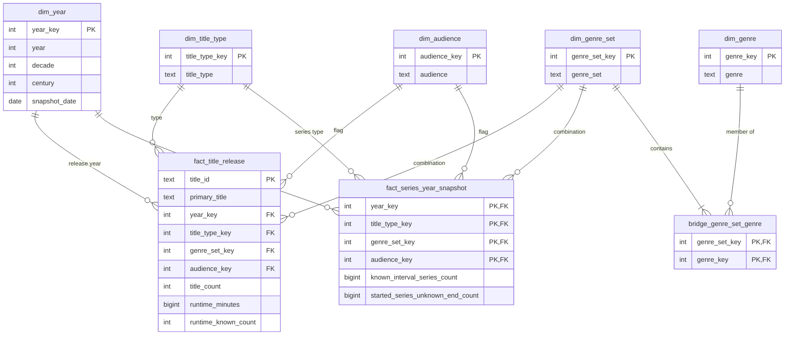
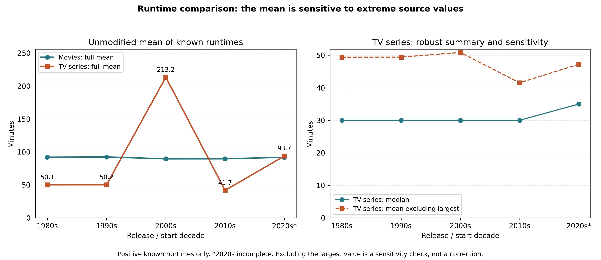
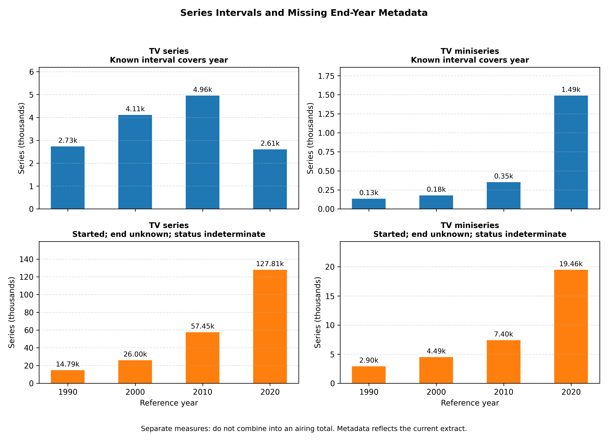
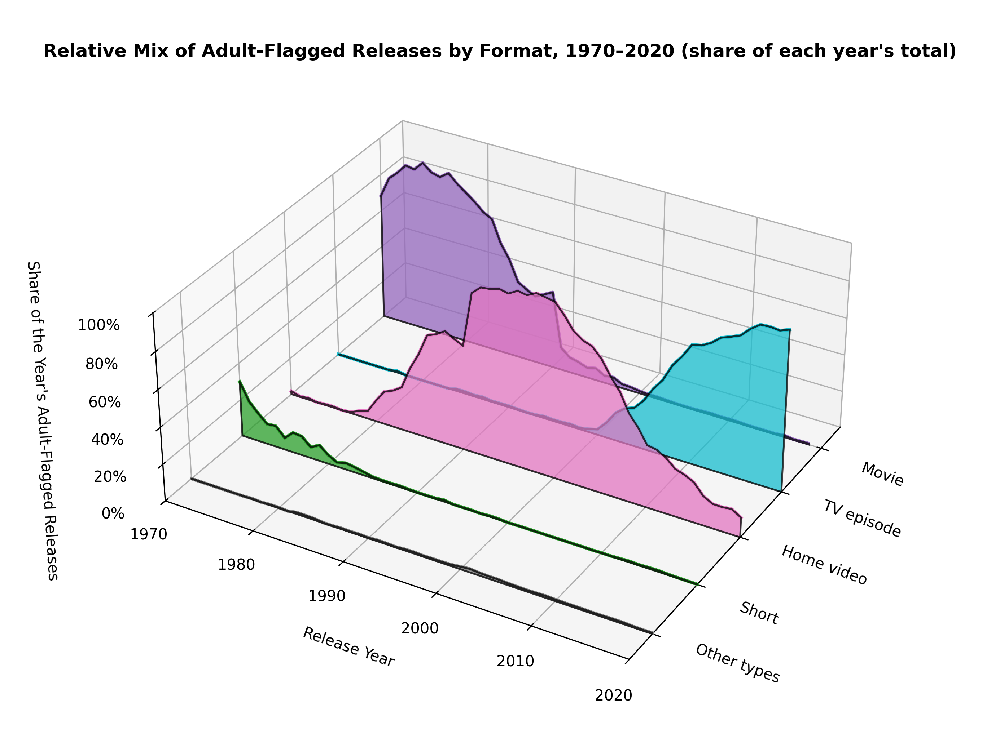
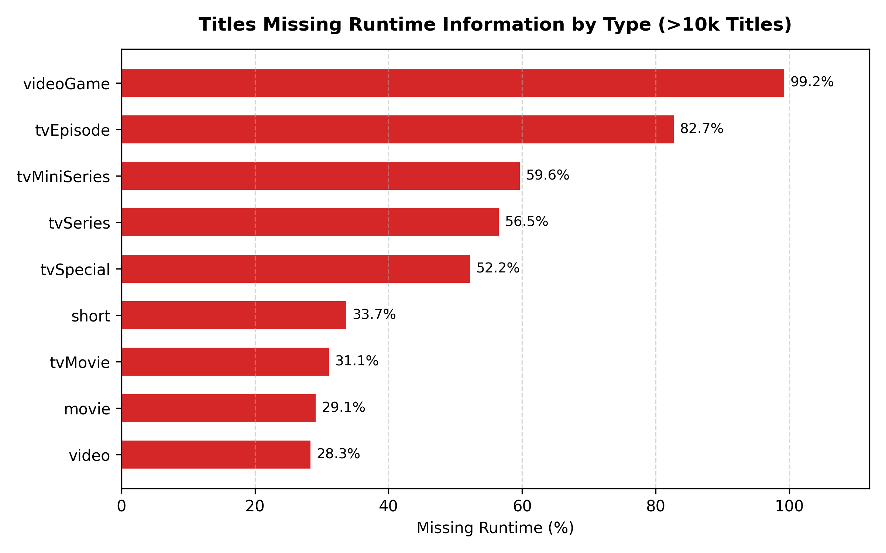

# Dimensional Analysis of IMDb Audiovisual Titles

Download the project dataset from [Google Drive](https://drive.google.com/file/d/1vTW1wmApo5b8ZvQGzIOJ8E2XF4GIFgJc/view?usp=sharing).

The implemented warehouse is the persistent local SQLite file `data/warehouse/warehouse.db`.
Its schema is defined in [sql/warehouse_schema.sql](sql/warehouse_schema.sql), with
primary keys, foreign keys, strict types and checks enforced during loading.
The CSV files in `data/refined/` are intermediate ETL outputs. Queries open the
existing database directly and do not recreate it or reload the CSV files.

## Project Structure

```text
projeto/
├── README.MD
├── scripts/                  # Transformation, loading, queries and shared paths
├── tests/                    # Transformation and warehouse tests
├── sql/                      # Persistent warehouse schema
├── docs/                     # Report guidelines
├── data/
│   ├── raw/                  # Source data.tsv
│   ├── refined/              # Generated CSVs and ETL validation report
│   └── warehouse/            # Persistent warehouse.db
└── media/                    # Analytical figures
```


## 1. Subject Description and Assignment Requirements

### 1.1. Subject and Objectives

This project analyses the evolution of audiovisual titles represented in an
IMDb metadata extract. It examines releases by year, known series intervals
and missing end-year metadata, distinguishing title types, genre combinations, and adult
content flags.

The model supports two analytical processes: counting titles in their release
or start year, and reconstructing annual snapshots of series interval information.
The second process separately counts known start/end intervals that cover the
reference year and already-started series with an unknown end year.

**Unknown means indeterminate:** a missing `endYear` does not imply that a series
is still airing. Such titles contribute only to a cumulative count of series
already started with missing end information. The two measures are reported
separately and are not combined into an estimate of series in airing. A known
interval covering a year also does not prove that episodes aired in that year.

The main analytical questions are:

- How has the annual number of released titles evolved?
- Which title types and genre combinations are most represented?
- How are releases distributed by adult content flag?
- What are the total known runtime and average known runtime by category and year?
- How many known series intervals cover each year, by type and genre combination?
- How many series had started by each year but have an unknown end year in the extract?

### 1.2. Data Source and Scope

The source is the local `data/raw/data.tsv` file, containing 7,697,093 records and the
fields `tconst`, `titleType`, `primaryTitle`, `originalTitle`, `isAdult`,
`startYear`, `endYear`, `runtimeMinutes`, and `genres`.

The file contains title metadata; it does not contain sales, revenue, viewing
figures, platform availability, or ratings. Analysis therefore focuses on the
number and characteristics of the titles present in this extract. The
acquisition date and extract version are not recorded in the project.

Records are included when `startYear` is numeric and falls between 1 and the
configured cutoff year. For series, this field represents the start year.
Titles without an eligible year are excluded without inventing dates. All
eligible title types are retained, including movies, series, and episodes.

The series snapshot includes only `tvSeries` and `tvMiniSeries`; individual
episodes, movies and other title types remain available in release facts.
Both start and end years are included in a known interval. Missing end years
(`\N` or an empty field) remain unknown: the series is included in the separate
already-started/unknown-end metadata count from its start through the reporting
cutoff. No end date or continued broadcasting is inferred.
Malformed end years and end years earlier than the start are excluded from the
snapshot and counted in the validation report; their release facts are retained.

The current results, recorded in [validation_report.json](data/refined/validation_report.json), are:

| Indicator | Value |
| --- | ---: |
| Source records | 7,697,093 |
| Release fact table records | 6,901,413 |
| Records excluded due to unknown or out-of-range years | 795,680 |
| Titles with known positive runtime | 2,138,467 |
| Total known runtime, in minutes | 94,369,177 |
| Series snapshot fact table records | 66,301 |
| Eligible series (`tvSeries` and `tvMiniSeries`) | 224,004 |
| Series with known end year | 73,634 |
| Series with unknown end year, airing status indeterminate | 150,370 |
| Series excluded from snapshots due to invalid end years | 0 |
| Time range | 1874–2026 |

The current cutoff is 2026. As of this model revision, 10 November 2026, this
year is still incomplete. Each snapshot describes the annual interval, not the
status on 31 December. The `snapshot_date` attribute is only a conventional
label for the year. To exclude the incomplete calendar year, regenerate with
`--cutoff-year 2025`; this does not resolve missing or outdated source metadata.

### 1.3. Mapping to Assignment Requirements

| Assignment requirement | Implementation |
| --- | --- |
| More than 10,000 facts | `fact_title_release` contains 6,901,413 records. |
| At least one additive measure | `title_count`, `runtime_minutes`, and `runtime_known_count` in the release fact table. |
| Aggregated facts or snapshots with a semi-additive measure | `fact_series_year_snapshot` separately counts known intervals covering a year and already-started series with unknown end, additive across disjoint categories within a year but not across years as distinct-series counts. |
| At least four dimensions, including a temporal dimension | Year, title type, genre combination, and adult content flag are directly referenced; individual genre is an additional dimension reached through a bridge. |
| Dimensions shared by both types of facts | The four direct dimensions are shared, as are the genre dimension and membership bridge through `genre_set_key`. |

The snapshots represent **annual series interval information**, using dates
and missing-end metadata in the extract. They do not establish
that episodes aired in every included year or describe what IMDb knew at each
historical date. Historically observed operational snapshots would require
an additional source with dated observations.

## 2. Dimensional Planning

### 2.1. Dimensional Bus Matrix

The matrix relates analytical processes to conformed dimensions: dimensions
with the same members, keys, and meaning in both processes.

| Process / fact table | Year | Title type | Genre combination | Adult content flag | Individual genre |
| --- | :---: | :---: | :---: | :---: | :---: |
| Releases — `fact_title_release` | X | X | X | X | Via bridge |
| Annual series interval information — `fact_series_year_snapshot` | X | X | X | X | Via bridge |

In the first table, the year identifies the title's release/start year. In the
second, it identifies the snapshot reference year. The dimension is shared,
but its temporal role depends on the process being analysed.
The title-type dimension is shared in full, but only its `tvSeries` and
`tvMiniSeries` members are referenced by the series snapshot.

### 2.2. Dimension Dictionary

The following logical types are implemented by [sql/warehouse_schema.sql](sql/warehouse_schema.sql).
SQLite `STRICT` tables use `INTEGER` for integer measures and `TEXT` for labels
and ISO-8601 dates; SQLite integers support the logical `BIGINT` measures below.
Category keys are integers assigned by the transformation process. The CSV
exports themselves do not enforce constraints; the persistent warehouse does.

#### Time Dimension — `dim_year`

Grain: one record per year, including years without releases between the
first eligible year and the configured cutoff. It currently contains 153 members.

| Attribute | Logical type | Role | Description |
| --- | --- | --- | --- |
| `year_key` | INTEGER | PK | Numeric natural key for the year. |
| `year` | INTEGER | Attribute | Calendar year. |
| `decade` | INTEGER | Attribute | First year of the decade, calculated using integer division; for example, 1990. |
| `century` | INTEGER | Attribute | Calendar century; for example, 2000 belongs to the 20th century and 2001 to the 21st. |
| `snapshot_date` | DATE | Attribute | Conventional label of 31 December for the reference year; not an observed airing date or year-end status. |

Supports aggregation from year to decade or from year to century. Decade and
century are alternative groupings: the decade convention used can cross a
century boundary. A strict decade → century hierarchy is not assumed.
The source used does not provide release months or days.

#### Title Type Dimension — `dim_title_type`

Grain: one record per source title type. It currently contains 13 members.

| Attribute | Logical type | Role | Description |
| --- | --- | --- | --- |
| `title_type_key` | INTEGER | PK | Surrogate key for the title type. |
| `title_type` | TEXT | Attribute | Original category, such as `movie`, `short`, or `tvEpisode`. |

#### Genre Combination Dimension — `dim_genre_set`

Grain: one record per distinct genre combination after sorting and removing
duplicates. It currently contains 2,244 members, including the `Unknown` member
for unknown genres.

| Attribute | Logical type | Role | Description |
| --- | --- | --- | --- |
| `genre_set_key` | INTEGER | PK | Surrogate key for the combination. |
| `genre_set` | TEXT | Attribute | Normalised genre list, such as `Comedy,Romance`, or `Unknown`. |

Each title belongs to exactly one combination. Analysis of `Comedy,Romance`
refers to that exact combination, rather than all comedy or romance titles.
Individual genre filtering uses the following dimension and bridge while
retaining this original combination and the grain of both fact tables.

#### Individual Genre Dimension — `dim_genre`

Grain: one record per distinct genre label, plus `Unknown` for the unknown
combination. There are 29 members, including `Unknown`. Labels retain the source's English names, such as `Comedy` and
`Romance`; searching for comedy uses `Comedy`.

| Attribute | Logical type | Role | Description |
| --- | --- | --- | --- |
| `genre_key` | INTEGER | PK | Surrogate key assigned in sorted label order. |
| `genre` | TEXT | Attribute | One individual genre label or the `Unknown` member. |

#### Genre Membership Bridge — `bridge_genre_set_genre`

Grain: one record per distinct combination × constituent genre, with 6,331
memberships in the current extract. The composite
primary key is `(genre_set_key, genre_key)`. This is a relationship table,
not a third fact table or a title-level bridge containing millions of rows.

| Attribute | Logical type | Role | Description |
| --- | --- | --- | --- |
| `genre_set_key` | INTEGER | PK component; FK → `dim_genre_set` | Genre combination. |
| `genre_key` | INTEGER | PK component; FK → `dim_genre` | One constituent genre. |

For example, `Comedy,Romance` has two memberships: `Comedy` and `Romance`.
Searching for `Comedy` therefore includes both `Comedy` and `Comedy,Romance`.
The `Unknown` combination has one membership to the `Unknown` genre member.

**Aggregation rule:** filters use `EXISTS`, so each fact row is selected once
even when multiple selected genres match. Selecting several genres uses OR
(any match). When reporting separately by individual genre, a hybrid title
contributes its full count to each applicable genre. Genre totals overlap and
must not be added together as a distinct-title total; runtime totals have the
same overlap. Exact genre combinations remain disjoint and additive.

#### Adult Content Flag Dimension — `dim_audience`

Grain: one record per interpreted value of `isAdult`. It currently contains
two observed members; the process also supports an `Unknown` member.

| Attribute | Logical type | Role | Description |
| --- | --- | --- | --- |
| `audience_key` | INTEGER | PK | Surrogate key for the classification. |
| `audience` | TEXT | Attribute | `Not adult-flagged`, `Adult-flagged`, or `Unknown`. |

This indicator is not an age rating and does not establish that an unflagged
title is suitable for children.

### 2.3. Fact Dictionary

#### Release Facts — `fact_title_release`

Grain: one record per source title with an eligible year. The primary key is
`title_id`, corresponding to `tconst`. SQLite enforces uniqueness and rejects
duplicate identifiers during warehouse loading.

| Attribute | Logical type | Role | Description / aggregation |
| --- | --- | --- | --- |
| `title_id` | TEXT | PK | IMDb title identifier, unique and non-null. |
| `primary_title` | TEXT | Descriptive | Main title name; not unique. |
| `year_key` | INTEGER | FK → `dim_year` | Release/start year. |
| `title_type_key` | INTEGER | FK → `dim_title_type` | Title type. |
| `genre_set_key` | INTEGER | FK → `dim_genre_set` | Genre combination. |
| `audience_key` | INTEGER | FK → `dim_audience` | Adult content flag. |
| `title_count` | INTEGER | Additive measure | Value of 1 per record; aggregated by summation. |
| `runtime_minutes` | BIGINT | Additive measure | Known positive runtime in minutes; zero when unknown or invalid. |
| `runtime_known_count` | INTEGER | Additive measure | Value of 1 when valid positive runtime exists, and 0 otherwise. |

The identifier acts as a degenerate dimension: it identifies the title without
creating an additional dimension containing millions of members. The name is
retained as a descriptive attribute in the detail fact table.

Average known runtime is a derived **non-additive** measure:

```text
average known runtime = SUM(runtime_minutes) / SUM(runtime_known_count)
```

Use decimal division and return null when the denominator is zero. Group
averages must not be summed or combined using an unweighted average of
averages; they must be recalculated from totals and counts.

#### Annual Series Interval Information — `fact_series_year_snapshot`

Grain: one record per reference year × series type × genre combination × adult
content flag with at least one nonzero measure. The logical primary
key combines the four foreign keys. Absent combinations represent zero.

| Attribute | Logical type | Role | Description / aggregation |
| --- | --- | --- | --- |
| `year_key` | INTEGER | PK component; FK → `dim_year` | Snapshot reference year. |
| `title_type_key` | INTEGER | PK component; FK → `dim_title_type` | `tvSeries` or `tvMiniSeries`. |
| `genre_set_key` | INTEGER | PK component; FK → `dim_genre_set` | Genre combination. |
| `audience_key` | INTEGER | PK component; FK → `dim_audience` | Adult content flag. |
| `known_interval_series_count` | BIGINT | Semi-additive measure | Series with valid known end year and `startYear <= reference year <= endYear`. |
| `started_series_unknown_end_count` | BIGINT | Semi-additive measure | Series with `startYear <= reference year` and missing end in the extract; actual airing status is indeterminate. |

Each measure can be summed across series types, genre combinations and
classifications within the same year. **Do not combine the measures as an airing
total or use their sum as the denominator of an airing-status percentage.** They
have different inclusion rules: the first describes known intervals covering a
year; the second accumulates already-started titles with missing end metadata.
The first is not the total number actually airing either: it excludes titles
whose intervals cannot be established. A known end beyond the cutoff remains
known and is evaluated only within the reporting years.

Do not sum annual values of either measure to obtain distinct series over a
period: a series can appear in several years. Such sums are reporting-year
memberships, not observed years of broadcast activity or distinct-title totals.
The snapshot contains no runtime measure because title runtime does not measure
the amount of content aired in a particular year.

## 3. Dimensional Data Model Explained

### 3.1. Structure and Relationships

The model is a **fact constellation**, with two facts sharing four directly
referenced dimensions. Each fact row references one member of each direct
dimension. An additional individual-genre dimension is connected through the
combination membership bridge, allowing both facts to be filtered by genre.



The diagram represents the relational schema implemented in `data/warehouse/warehouse.db`.
SQLite enforces the primary keys, foreign keys, nullability, strict physical
types and measure checks. An additional `warehouse_metadata` table records
the build timestamp, source report and database validation results; it is
operational metadata, not a third dimensional fact table.

### 3.2. Rationale for Design Decisions

**Separating the two processes.** The release fact table answers questions
about what was released in a given year. The snapshot separately describes known
intervals covering that year and already-started series with missing end metadata.
A known-ended series leaves the interval count after its end year; unknown-ended
titles remain in a metadata accumulation without being labelled as airing.
The snapshot uses `endYear`, which cannot be recovered from release counts.

**Two fact tables.** A separate cumulative-catalog fact is not retained. Cumulative
release counts can be calculated from release facts if needed. The stored snapshot
instead supports the distinct analysis of series lifecycles. It still materialises
derived data, with storage and maintenance costs, but adds information about ends.

**Conformed dimensions.** Both processes use the same keys and descriptions,
allowing new series, known intervals and missing-end metadata to be analysed with the same filters.
For this comparison, release facts must be restricted to `tvSeries` and
`tvMiniSeries`. There is no direct relationship between the fact tables.
Comparing them requires first aggregating each table to the desired common
grain, avoiding row multiplication caused by a direct join.

**Genre combinations and individual genres.** Combinations remain the fact
foreign keys, preserving disjoint categories. The combination-to-genre bridge
provides membership filtering without expanding either fact table. `EXISTS`
prevents duplicate rows in OR filters. Reports grouped by individual genre have
overlapping categories, so their totals must not be summed into an overall count.

**The role of `endYear`.** Source end years are used during ETL to establish
series interval membership. They do not require another dimension for the
current aggregated snapshot: its year key is the reference year, not the end
year of every series in a group. One group can contain series with different
ends. Individual end years are not retained in the facts. Exposing them for
title-level analysis would require detail storage, such as an `end_year_key`
referencing the existing `dim_year` in the role of end year (with explicit
unknown handling and coverage of known ends beyond the cutoff). This would
reuse the temporal dimension rather than add an `endYear` attribute to each
snapshot category or create a separate end-year dimension.

**Annual temporal precision.** Start and end dates have year precision, so the
time dimension has an annual grain. The 31 December label identifies the
reference year, not an actual release date or status on that day. The snapshot
includes a series that ended at any point in the reference year.

**Unknown runtime.** Unknown, non-numeric, or non-positive values contribute
zero to total runtime and zero to `runtime_known_count`. This zero is an
aggregation convention; it does not mean that the title actually lasts zero minutes.

### 3.3. Snapshot Construction and Interpretation

For eligible `tvSeries` and `tvMiniSeries`, the two measures have separate rules:

```text
known_interval_series_count:
    valid known endYear and startYear <= reference_year <= endYear

started_series_unknown_end_count:
    missing endYear and startYear <= reference_year
```

The cutoff limits reporting years; it is not an inferred end date. Missing
`endYear` values (`\N` or empty) remain unknown. Malformed non-missing ends or
ends before the start are excluded from the snapshot and logged separately.
Their release facts remain available.

For known intervals, the ETL adds one at the start and subtracts one in the year
after the end. For missing ends, it accumulates already-started titles as a
metadata count. These titles remain in that count through the reporting cutoff,
without asserting that they continue airing. Groups are aggregated by the four
foreign keys; groups with both measures zero are omitted.

For example, series A starts in 2018 and ends in 2020; series B starts in 2019
and has no end year. With a 2021 reporting cutoff and the same categories:

| Year | New series releases | Known interval covers year | Started with unknown end; status indeterminate |
| --- | ---: | ---: | ---: |
| 2018 | 1 | 1 | 0 |
| 2019 | 1 | 1 | 1 |
| 2020 | 0 | 1 | 1 |
| 2021 | 0 | 0 | 1 |

In 2021, A's known interval no longer covers the year. B has started and its end
is unknown; this does not establish whether it was airing in 2021. No combined
airing total is produced. Summing either column across years counts repeated
reporting-year memberships, not distinct series or observed broadcast years.
Known/unknown end classification reflects the current extract's information,
not what was known at each historical date.

### 3.4. Analytical Limitations

- Snapshots reconstruct annual series intervals from the extract; they are not
  observations of actual broadcasting schedules or historical IMDb membership.
- Missing end years leave airing status indeterminate. Their cumulative metadata
  count cannot establish how many of those series were actually airing.
- A known end year removes a series from later known-interval counts, while its
  release fact remains. Gaps, hiatuses and revivals are not represented.
- Coverage depends on the extract and on known years. Counts do not establish
  the total volume of worldwide audiovisual production.
- The year 2026 is incomplete, and the extract does not establish that all
  titles assigned to that year had actually been released by the preparation date.
- Movies, series, and episodes are distinct entities in the source. Specific
  analyses should filter by type. Summing runtimes across series and episodes
  does not necessarily represent minutes of unique content.
- The adult content flag does not replace an age rating.

## 4. Transformation, Execution, and Validation

The [scripts/refine_dataset.py](scripts/refine_dataset.py) script uses only Python's standard
library and preserves the source file. The process:

1. Reads `data/raw/data.tsv` and selects records with eligible years.
2. Normalises genre combinations and interprets the adult content flag.
3. Assigns category keys and writes release facts.
4. Generates the four direct dimensions, individual genres and the combination-to-genre bridge.
5. Writes known-interval counts and separate cumulative counts of started series with unknown end, without imputing airing status.
6. Checks the fact threshold, nonnegative counts, reporting-year memberships and final-year counts against each measure's source rules.

Then [scripts/build_warehouse.py](scripts/build_warehouse.py) loads these outputs into the
persistent database, using only Python's standard library and SQLite 3.37+.

Run in PowerShell from the project directory:

```powershell
# Reproduce the current version's cutoff
.\venv\Scripts\python.exe -m scripts.refine_dataset --cutoff-year 2026

# Load the persistent database after generating CSVs
.\venv\Scripts\python.exe -m scripts.build_warehouse

# Verify an existing database without rebuilding it or reading CSVs
.\venv\Scripts\python.exe -m scripts.build_warehouse --verify

# Run analytical queries without matplotlib or figure generation
.\venv\Scripts\python.exe -m scripts.run_queries --no-plots

# Boundary and reconciliation tests (small synthetic dataset)
.\venv\Scripts\python.exe -m unittest discover -s tests -v

# Execute the five queries and regenerate figures using Python with matplotlib
python -m scripts.run_queries

# Search individual genres while retaining each title's full genre combination
.\venv\Scripts\python.exe -m scripts.run_queries --genre Comedy --snapshot-year 2020

# OR search: each matching title or snapshot row contributes once
.\venv\Scripts\python.exe -m scripts.run_queries --genre Comedy --genre Romance --snapshot-year 2020

# Optional separate version with an earlier cutoff
.\venv\Scripts\python.exe -m scripts.refine_dataset --cutoff-year 2025 --output data/refined_2025
.\venv\Scripts\python.exe -m scripts.build_warehouse --source data/refined_2025 --database data/warehouse/warehouse_2025.db
.\venv\Scripts\python.exe -m scripts.run_queries --database data/warehouse/warehouse_2025.db --no-plots
```

The transformation replaces files in `data/refined/`; it does not update the database
until `scripts/build_warehouse.py` is run. Queries default to `data/warehouse/warehouse.db`, with
`--database` available for another version. The default generated database is
ignored by Git and should be regenerated using these commands when reproducing
the project.

### 4.1. Persistent Database and Integrity

The loader creates a temporary database next to the destination, applies the
schema, and loads all five dimensions before the bridge and facts. All data
inserts and index creation occur in one transaction with
`PRAGMA foreign_keys = ON`. It creates indexes for release type/year and genre
filtering, then runs `ANALYZE` to support query planning.

Enforced rules include dimension primary keys and unique labels, the release
`title_id` primary key, the four-key snapshot primary key, the two-key bridge
primary key, and foreign keys for every dimensional reference. Checks reject
negative counts/runtimes, a release count other than one, inconsistent runtime
availability, and empty snapshot groups. Triggers reject snapshot inserts or
type changes referring to title types other than series and miniseries.

Before publishing the new database, the loader runs `PRAGMA foreign_key_check`
and `PRAGMA integrity_check`, checks all table counts against the ETL report,
and reconciles release measures, snapshot reporting-year memberships and cutoff-year totals.
It also verifies the full genre membership mapping and series-type scope.
Build metadata and validation results are stored inside `warehouse_metadata`.

Only a successfully committed and validated database replaces `data/warehouse/warehouse.db`.
If loading or validation fails, the temporary build is removed and the previous
database is preserved. Queries use a read-only connection to the existing file;
a missing database produces an error instead of silently creating an empty one.
Closing the query process leaves the warehouse on disk. `--verify` repeats
database checks using its internally stored source report, without the CSVs.

Any other SQLite client that opens a writable connection must also execute
`PRAGMA foreign_keys = ON`, because SQLite controls foreign-key enforcement
per connection. The project's connection helper enables it for every connection.

The current database uses schema version 2 and the ETL report records
`snapshot_semantics_version: 2`. Version 1 databases or reports are rejected so
old assumed-ongoing semantics cannot be silently reused. To upgrade, regenerate
CSVs with `python -m scripts.refine_dataset` and rebuild with
`python -m scripts.build_warehouse`; normal queries never mutate the schema.

### 4.2. Intermediate Files and Transformation Checks

| Generated file | Contents |
| --- | --- |
| `dim_year.csv` | Time dimension. |
| `dim_title_type.csv` | Title types. |
| `dim_genre_set.csv` | Genre combinations. |
| `dim_genre.csv` | Individual genre labels, including `Unknown`. |
| `bridge_genre_set_genre.csv` | Unique combination-to-genre memberships. |
| `dim_audience.csv` | Adult content flags. |
| `fact_title_release.csv` | Facts per title. |
| `fact_series_year_snapshot.csv` | Known intervals covering each year and started series with unknown end, reported separately. |
| `validation_report.json` | Counts, exclusions, and control totals. |

The persistent result is `data/warehouse/warehouse.db` under `data/warehouse/`; the SQL schema and
Python loader are versioned so it can be rebuilt from the intermediate files.

The script checks that there are more than 10,000 release facts. Known-interval
memberships reconcile against inclusive interval lengths within the reporting
range. Unknown-end memberships reconcile against the number of reporting years
from each start through the cutoff, without inferring a real end. Each final-year
measure is checked separately. These are technical reconciliations, not distinct
series or observed broadcast-year metrics. Invalid end years are counted separately.

The synthetic tests check inclusive boundaries, unknown ends, known ends beyond
the cutoff, invalid intervals, non-series exclusion, an empty snapshot, dimension
references and unique snapshot keys. Database tests additionally verify enforced
primary and foreign keys, checks and types, persistence after CSV removal,
read-only queries, and preservation of the previous database after duplicate
input or inconsistent control totals. Surrogate keys depend on source reading
order; dimensions and facts must be loaded from the same execution.
After successful generation, the script removes the obsolete generated
`fact_year_end_catalog.csv`. The warehouse loader explicitly loads the five
dimensions, membership bridge and two fact tables. The query script opens the
persistent result directly.

Genre membership tests also cover mixed genres, duplicate source labels,
case-insensitive filtering, OR searches without double counting, unknown genres
and the same filter applied to the annual snapshot. Search values are passed
as SQL parameters. The CLI prints matching release counts, series interval information
for the selected year as two separate counts, and up to 20 matching titles with their full combination.

For example, a title search for `Comedy` can use this SQL. Replace the literal
with a bound parameter in application code. To search any of several genres,
use `IN ('Comedy', 'Romance')` inside the same `EXISTS` clause.

```sql
SELECT f.title_id, f.primary_title, s.genre_set
FROM fact_title_release f
JOIN dim_genre_set s ON s.genre_set_key = f.genre_set_key
WHERE EXISTS (
    SELECT 1
    FROM bridge_genre_set_genre b
    JOIN dim_genre g ON g.genre_key = b.genre_key
    WHERE b.genre_set_key = f.genre_set_key
      AND g.genre = 'Comedy'
);
```

The same membership predicate applies to `fact_series_year_snapshot` via its
`genre_set_key`. Filter to one reference year before summing snapshot measures.

## 5. Querying and Data Analysis

This section exemplifies the use of the dimensional model to extract analytical insights from the IMDb metadata. The queries presented utilize both fact tables, taking advantage of their additive and semi-additive properties, and cross-reference multiple conformed dimensions.

### 5.1. Analytical Questions Addressed

To demonstrate the capabilities of the data warehouse, five core analytical questions were explored:

1. How has the volume of releases and their average runtime evolved across decades for movies and TV series?
2. How do known intervals covering a year compare with the cumulative number of started series whose end year is unknown?
3. Which title types exhibit the highest proportion of adult-flagged content?
4. What is the data quality regarding runtime information, specifically the percentage of missing values per title type?
5. What are the top 5 most frequent exact genre sets for movies overall, and how does dimensional modeling affect this ranking?

### 5.2. Data Interpretation and Insights

The queries are executed directly against the persistent local SQLite warehouse, populated and validated separately by the loader. The results highlight the distinction between the observed data within the IMDb extract, the underlying market realities, and the analytical implications of the chosen dimensional grain.

**A. Evolution of TV Formats vs. Movies (Query 1)**

The release fact table (`fact_title_release`) was grouped by decade and title type to calculate the average known runtime.

-   **Observed Results:** The data shows that the average runtime for movies has remained highly stable over the last four decades, consistently hovering between 89 and 92 minutes. In stark contrast, the average runtime for TV series (`tvSeries`) dropped significantly, from around 52 minutes in the 1980s and 1990s, to approximately 41 to 44 minutes in the 2010s and 2020s.
-   **Interpretation:** This sharp decline does not necessarily mean that traditional television episodes have become shorter. Instead, it reflects a structural shift in the audiovisual market. The explosion of web series, short-form animated shows, and non-traditional digital formats in recent decades pulls the global average down, diluting the classic "1-hour" broadcast television format within the dataset.



**B. Known Series Intervals and Indeterminate End Metadata (Query 2)**

The snapshot is filtered for reference years 1990, 2000, 2010 and 2020 and grouped
by series type. The measures are shown separately; they have different inclusion
rules and are not combined into a total or percentage of series in airing.

| Reference year | Series type | Known intervals covering year | Started with unknown end; status indeterminate |
| --- | --- | ---: | ---: |
| 1990 | `tvSeries` | 2,734 | 14,794 |
| 1990 | `tvMiniSeries` | 133 | 2,900 |
| 2000 | `tvSeries` | 4,107 | 25,996 |
| 2000 | `tvMiniSeries` | 177 | 4,494 |
| 2010 | `tvSeries` | 4,959 | 57,452 |
| 2010 | `tvMiniSeries` | 352 | 7,400 |
| 2020 | `tvSeries` | 2,606 | 127,815 |
| 2020 | `tvMiniSeries` | 1,490 | 19,464 |

- **Observed results:** 2,606 TV series have known intervals covering 2020.
  Another 127,815 TV series had started by then but have no recorded end in this
  extract. Miniseries have 1,490 known intervals covering 2020 and 19,464
  already-started titles with missing ends.
- **Interpretation:** the second measure accumulates missing-end metadata among
  titles started by each reference year. Its growth does not demonstrate growth
  in actual broadcasting activity. The first measure also cannot establish the
  true airing total because it omits series whose intervals are unknown.
- **Limitations:** at the 2026 cutoff, five known series intervals cover the year;
  150,370 already-started series have unknown ends and indeterminate status.
  Neither figure describes the total actually airing. These results show the
  limits of this extract's date information, not the size of the active market.
  Both classifications use current extract metadata rather than historical
  observations. Even a known interval does not reveal hiatuses or episode dates.
- **Aggregation:** each measure is compared separately between years. Summing
  annual values gives reporting-year memberships, not distinct series over the
  period. The figure therefore uses separate panels instead of stacked totals.



**C. Distribution of Adult-Flagged Content Across Title Types and Decades (Query 3)**

By cross-referencing `dim_title_type`, `dim_audience` and `dim_year`, the analysis isolates the adult-flagged titles and follows how their format mix changes over time. Each format is read as a percentage of the adult-flagged titles of its own decade (and, in the figure, of its own year) rather than as a raw count. This matters because the volume of adult-flagged titles grows roughly 42× between the 1970s (3,105 titles) and the 2010s (131,180), so raw counts would let the most recent decades drown out everything before them.

-   **Observed Results:** The format mix is almost completely replaced over five decades, in three successive handovers. Across the whole period, TV episodes account for 56.6% of the 232,891 adult-flagged titles, home video for 38.3% and theatrical movies for only 3.8%.
    -   **1970s, the theatrical era:** movies make up 86.2% of adult-flagged titles. Most of the remaining 12.5% is shorts (a follow-up check over 1970–1985 puts shorts at 7.4%), while video is still marginal at 1.2%.
    -   **1980s–1990s, home video takes over:** video jumps from 1.2% to 45.3% in the 1980s, almost level with movies (52.2%), and reaches 90.5% in the 1990s, when movies are down to 7.7%. Movies peak in absolute terms in the 1980s (3,399 titles) and never return to that volume.
    -   **2000s–2010s, TV episodes take over:** episodes go from under 1% in the 1990s to 34.0% in the 2000s and 76.7% in the 2010s (100,590 titles). Video is still the majority in the 2000s (64.1%, its absolute peak at 40,810 titles) but falls to 21.6% in the 2010s. It also falls in absolute terms (28,346 titles), so its loss of share is not just dilution by a growing total.
    -   **Everything else:** theatrical movies stay at or below roughly 1.5% from the 2000s onwards, and shorts plus all remaining formats combined stay under 2% from the 1980s onwards.
-   **Interpretation:** The data shows three successive handovers (theatrical movies, then home video, then TV episodes), each leading format giving up most of its share within one to two decades. This is consistent with adult production moving away from film-based distribution towards home video and later towards episodic, online-style distribution. The data only shows how IMDb classifies these titles, so the causes behind the shifts remain an interpretation. After the 1980s, theatrical movies are a negligible share, which fits the idea that this content rarely follows traditional theatrical pipelines.
-   **Data Notes and Limitations:** The 2020s are truncated: the source holds almost no adult-flagged titles after 2021 (9,478 in 2020, 1,312 in 2021, 2 in each of 2022 and 2023, none afterwards), so that decade reflects essentially two years (87.7% TV episodes, 10.1% video) and is not comparable to a full decade. For the same reason the figure stops at 2020. The percentages describe what adult-flagged content is made of, not how much of each format is adult-flagged, which would require each format's full catalog as the denominator.

The figure below shows the same composition at annual resolution (1970–2020), which makes the timing of each handover visible. For every year, each ridge is a format's share of that year's adult-flagged titles, so the five ridges always add up to 100%. Shorts get their own ridge because of their weight in the early years, while all remaining types (including `tvSeries`) are grouped as "Other types". Years with fewer than 25 adult-flagged titles are omitted so that tiny samples do not distort the percentages.



**D. Data Quality and Completeness (Query 4)**

A critical role of a data warehouse is exposing operational data quality issues. The release fact table was queried to compare total releases (`title_count`) against titles with valid durations (`runtime_known_count`).

-   **Observed Results:** The analysis reveals severe data sparsity regarding technical metadata. Approximately 82.7% of all recorded TV episodes (`tvEpisode`) and 99.3% of video games (`videoGame`) completely lack runtime information.
-   **Interpretation:** This demonstrates that IMDb's operational data collection prioritizes cataloging the existence of a title over its secondary technical metadata. For analytical purposes, this validates the inclusion of the `runtime_known_count` additive measure in the model: any aggregation of "average duration" that divides by total row counts rather than known runtime counts would be severely distorted.



**E. Genre Sets and the Combinatorial Fragmentation Effect (Query 5)**

Querying `fact_title_release` with `dim_genre_set` for theatrical movies (`movie`) reveals the top five exact genre strings recorded in the warehouse.

-   **Observed Results:** Standalone `'Drama'` (90.3k) and `'Documentary'` (73.6k) rank first and second by a wide margin, followed by standalone `'Comedy'` (35.5k), `'Drama,Romance'` (11.2k), and `'Comedy,Drama'` (10.6k).
-   **Interpretation:** This is a ranking of exact combinations, not individual genres. Titles tagged `Comedy` together with another genre are counted in a different combination from standalone `Comedy`. The model preserves this view, but now also supports membership searches through `dim_genre` and `bridge_genre_set_genre`. An individual-genre search for `Comedy` includes those hybrid titles; its result must not be confused with the standalone combination count or added to another overlapping genre total.


## 6. Critical Reflection: Dimensional Model vs. the Operational Source

The only source available to the project is `data/raw/data.tsv`, a flat extract of IMDb title metadata. No assumption is made about how IMDb stores its data internally: the comparison is between the dimensional model built in this project and the extract it was built from, which plays the role of the operational data.

### 6.1. Comparison with the Source Extract

| Aspect | Source extract (`data/raw/data.tsv`) | Dimensional model |
| --- | --- | --- |
| Structure | One flat table with 7,697,093 records and nine text fields. | Two fact tables, four directly shared dimensions, an individual-genre dimension and a membership bridge. |
| Measures | Only `runtimeMinutes`, stored as text with `\N` for unknown values. | Additive and semi-additive measures with explicit aggregation rules. |
| Unknown values | Encoded as `\N` and handled differently by each query. | Handled in the ETL: `Unknown` members, runtime availability and an explicit indeterminate-end metadata count. |
| Genres | One comma-separated string per title. | One normalised combination per title, plus individual genre memberships for both facts. |
| Annual series intervals | Must filter series, interpret `startYear`/`endYear` and evaluate intervals for each reference year. | Precomputed in `fact_series_year_snapshot`, with separate known-end and unknown-end counts. |
| Integrity | None; the file is plain text. | Primary keys, foreign keys, strict types and checks enforced in persistent SQLite tables, with transactional loading and reconciliation. |

### 6.2. Advantages of the Dimensional Model

**Consistent and standardised measures.** Release counts and runtime totals are additive; `known_interval_series_count` and `started_series_unknown_end_count` are semi-additive across time. Average known runtime is derived as `SUM(runtime_minutes) / SUM(runtime_known_count)` and is non-additive. The snapshot measures have different inclusion rules and are never combined into an airing total. Missing metadata remains explicitly indeterminate.

**Shared dimensions across fact tables.** Both fact tables share year, title type, genre combination and adult content flag. New series releases, known intervals covering a year and started titles with missing end can be compared with consistent filters after restricting releases to series types and aggregating each table to a common grain. These measures retain their separate meanings.

**Simpler analytical queries and reporting.** Query 2 separately aggregates the two measures in the 66,301-row snapshot instead of repeatedly evaluating source dates and missingness across 7,697,093 records. Neither queries nor figures impute continued airing for a missing end.

**Visible data quality.** Query 4 exposes unknown runtimes, while Query 2 shows how much end-year metadata is unavailable among series started by a reference year. Of 224,004 eligible series, 150,370 have no end year. The model reports this gap without interpreting those titles as ongoing.

**Separation of processes.** A release is counted once. Known intervals contribute to each covered reference year, while missing-end titles contribute to a cumulative metadata count. Only the first uses an established end to remove a title from later years. Both are semi-additive across time, and neither is a verified broadcast history.

### 6.3. Limitations

**Additional storage for snapshots.** `fact_series_year_snapshot` materialises interval-derived counts, so a series may contribute to many annual rows. This storage is justified by interval analysis and simple queries, but it remains derived data that must be maintained. A third fact table for cumulative releases is unnecessary; that result can be calculated from release facts.

**Maintenance of the ETL process.** Each new extract requires transformation followed by rebuilding the warehouse. Surrogate keys depend on source reading order, so dimensions and facts must be loaded together. The loader enforces integrity and preserves the previous database if a rebuild fails. The cutoff year must still be managed, and the current implementation performs full refreshes rather than incremental updates. SQLite is suitable for this local project; multi-user operation and larger deployments would require additional operational design.

**Loss of detail from the original dataset.** `originalTitle` is not retained. `endYear` is now used to construct series snapshots, but individual end years are not stored in the aggregate, so title-level interval investigations still require the source. There are 795,680 records excluded for unknown or out-of-range start years. The extract contains no ratings, votes, people, regions or viewing figures, so the model cannot answer questions about popularity, audiences or revenue.

**Overlapping individual genres.** Exact combinations remain disjoint, while the membership bridge supports individual genre searches across combinations. Filtering with `EXISTS` avoids duplicate counting even for multiple selected genres. Grouping by individual genre has a different rule: a `Comedy,Romance` title appears once in each genre, so summing those groups would count it twice. No fractional allocation is applied; each genre receives the title's full contribution.

**Incomplete intervals and indeterminate status.** A missing `endYear` leaves actual airing status unknown, including for miniseries. The model does not estimate how many of these titles were active. Known intervals do not reveal hiatuses or years without episodes either. Membership of either group reflects the current extract's metadata, not what was known in each historical year. Neither group is a complete count of series actually airing.

**Annual time granularity.** Start and end years have no month or day precision. A series ending during a year remains included in that year's snapshot. The `31 December` label does not establish that it was still airing on that day.

**Interpretation risks.** Movies, series and episodes are distinct entities, so adding their runtimes does not measure unique content. The adult content flag is not an age rating, and semi-additive measures can still be misused by users who do not know the rule.

### 6.4. Overall Assessment

For release volume, composition, runtime and series interval metadata, the model provides consistent measures and simpler queries. The snapshot uses known ends to evaluate recorded intervals and exposes missing ends separately. It deliberately leaves actual airing totals unanswered because the extract cannot establish them. Costs include snapshot storage, ETL maintenance and lost title-level detail. Actual broadcasting activity and historical source states require additional data.

## 7. Conclusion

This project implements a fact constellation with two fact tables: `fact_title_release`, with 6,901,413 records and the additive measures `title_count`, `runtime_minutes` and `runtime_known_count`; and `fact_series_year_snapshot`, with 66,301 records and the semi-additive measures `known_interval_series_count` and `started_series_unknown_end_count`. Both share four conformed dimensions: year, title type, genre combination and adult content flag. This satisfies the requirements for more than 10,000 facts, additive and semi-additive measures, and four shared dimensions including time.

For `tvSeries` and `tvMiniSeries`, the snapshot counts valid known intervals that cover each year and separately accumulates already-started series whose end is unknown. **An unknown end means indeterminate airing status.** The two measures are not added into an airing total, and known intervals alone do not establish the actual total either.

The transformation and warehouse loader build the model reproducibly, enforcing its keys and constraints and reconciling control totals before saving `data/warehouse/warehouse.db`. Five analytical queries run directly against this persistent database:

- **Query 1:** the average runtime of movies is stable across recent decades, while that of TV series decreases.
- **Query 2:** known intervals covering a year and started series with unknown end are reported separately, exposing incomplete metadata without imputing airing status.
- **Query 3:** adult-flagged content moves from theatrical movies to home video and then to TV episodes.
- **Query 4:** some title types, mainly `tvEpisode` and `videoGame`, lack runtime in most records.
- **Query 5:** exact genre combinations fragment hybrid genres and favour those that are rarely combined.

In each case, observed results were separated from possible explanations, because an increase in recorded titles may reflect changes in dataset coverage rather than an increase in audiovisual production.

The main conclusions are methodological. Declaring the grain and the aggregation rule of each measure avoids errors such as averaging averages or adding snapshots across years. Design decisions have analytical consequences: using genre combinations as a dimension simplifies counting but alters genre rankings. A warehouse built from a single extract inherits its limits, since its snapshots are reconstructed rather than observed and its coverage is uneven over time.

Individual-genre searches are supported by a shared combination-to-genre bridge while preserving the exact-combination analysis. Persistent relational storage, enforced constraints and transactional loading are implemented locally with SQLite. Future work could include incremental refreshes, title-level end-year analysis, and dated or episode-level sources to establish actual yearly activity. Regenerating with `--cutoff-year 2025` excludes the incomplete calendar year, but does not resolve missing ends or uneven source coverage.
