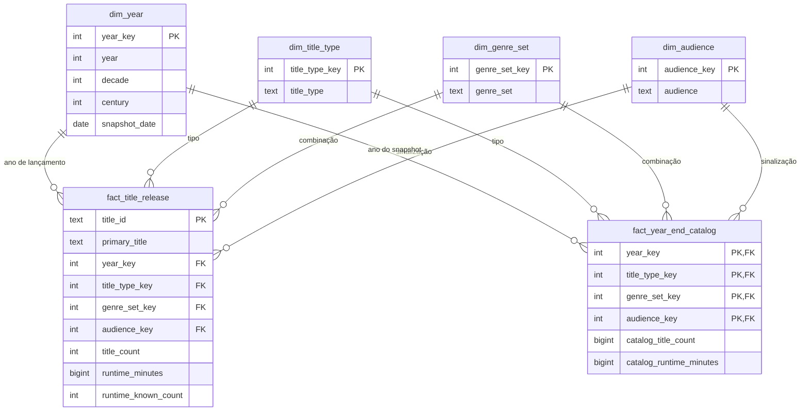

# Análise dimensional de títulos audiovisuais do IMDb

## 1. Descrição do tema e requisitos do trabalho

### 1.1. Tema e objetivos

Este projeto tem como tema a análise da evolução dos títulos audiovisuais
representados numa extração de metadados do IMDb. Pretende-se estudar os
lançamentos por ano e a evolução do catálogo acumulado, distinguindo o tipo de
título, a combinação de géneros e a sinalização de conteúdo adulto.

O modelo suporta dois processos analíticos: a contabilização dos títulos no
respetivo ano de lançamento/início e a reconstrução do total de títulos
lançados até ao final de cada ano. Assim, permite analisar tanto a atividade
anual como a dimensão acumulada do catálogo representado na extração.

As principais perguntas de análise são:

- Como evoluiu o número anual de títulos lançados?
- Quais os tipos de título e as combinações de géneros mais representados?
- Como se distribuem os lançamentos pela sinalização de conteúdo adulto?
- Qual a duração total conhecida e a duração média conhecida por categoria e ano?
- Quantos títulos da extração tinham sido lançados até determinado ano?
- Como evoluiu a composição do catálogo acumulado?

### 1.2. Fonte de dados e âmbito

A fonte utilizada é o ficheiro local `data.tsv`, com 7 697 093 registos e os
campos `tconst`, `titleType`, `primaryTitle`, `originalTitle`, `isAdult`,
`startYear`, `endYear`, `runtimeMinutes` e `genres`.

O ficheiro contém metadados de títulos; não contém vendas, receitas, visualizações,
disponibilidade em plataformas ou avaliações. As análises incidem, portanto,
na quantidade e nas características dos títulos presentes nesta extração.
A data de obtenção e a versão da extração não estão registadas no projeto.

São incluídos os registos com `startYear` numérico entre 1 e o ano-limite
configurado. Para séries, este campo corresponde ao ano de início. Os títulos
sem ano elegível são excluídos, sem se inventarem datas. Todos os tipos de
título elegíveis são mantidos, incluindo filmes, séries e episódios.

Os resultados atuais, registados em [validation_report.json](refined/validation_report.json), são:

| Indicador | Valor |
| --- | ---: |
| Registos na fonte | 7 697 093 |
| Registos na tabela de factos de lançamentos | 6 901 413 |
| Registos excluídos por ano desconhecido ou fora do intervalo | 795 680 |
| Títulos com duração conhecida e positiva | 2 138 467 |
| Soma das durações conhecidas, em minutos | 94 369 177 |
| Registos na tabela de snapshots | 402 194 |
| Intervalo temporal | 1874–2026 |

O limite atual é 2026. À data de elaboração, 2 de novembro de 2026, este ano
ainda está incompleto. O snapshot identificado por `2026-12-31` é uma referência
convencional de fim de ano, calculada a partir da extração disponível, e não uma
observação realizada nessa data. Para analisar apenas anos civis completos,
deve gerar-se novamente o conjunto com `--cutoff-year 2025`.

### 1.3. Correspondência com os requisitos

| Requisito do trabalho | Implementação |
| --- | --- |
| Mais de 10 000 factos | A tabela `fact_title_release` contém 6 901 413 registos. |
| Pelo menos uma medida aditiva | `title_count`, `runtime_minutes` e `runtime_known_count` na tabela de lançamentos. |
| Factos agregados ou snapshots com uma medida semi-aditiva | A tabela `fact_year_end_catalog` contém contagens e durações acumuladas, aditivas entre categorias num mesmo ano e não aditivas ao longo dos anos. |
| Pelo menos quatro dimensões, incluindo uma temporal | Ano, tipo de título, combinação de géneros e sinalização de conteúdo adulto. |
| Dimensões comuns aos dois tipos de factos | As quatro dimensões são partilhadas pelas duas tabelas de factos. |

A interpretação dos snapshots é a de **catálogo de lançamentos reconstruído**:
contam-se os títulos desta extração cujo ano de lançamento/início é anterior
ou igual ao ano analisado. Não se pretende representar o conteúdo efetivo da
base de dados IMDb em cada data histórica. Caso o enunciado exija snapshots
operacionais observados historicamente, será necessária uma fonte adicional
com observações datadas.

## 2. Planeamento dimensional

### 2.1. Matriz de barramento dimensional

A matriz relaciona os processos analíticos com as dimensões conformadas,
isto é, dimensões com os mesmos membros, chaves e significado em ambos os processos.

| Processo / tabela de factos | Ano | Tipo de título | Combinação de géneros | Conteúdo adulto |
| --- | :---: | :---: | :---: | :---: |
| Lançamentos — `fact_title_release` | X | X | X | X |
| Catálogo acumulado anual — `fact_year_end_catalog` | X | X | X | X |

Na primeira tabela, o ano identifica o lançamento/início do título. Na segunda,
identifica o ano de referência do snapshot. A dimensão é comum, mas o seu papel
temporal depende do processo analisado.

### 2.2. Dicionário de dimensões

Os tipos seguintes são tipos lógicos propostos para importação numa base de
dados relacional. Os ficheiros CSV não impõem tipos, chaves ou restrições.
As chaves de categoria são inteiros atribuídos pelo processo de transformação.

#### Dimensão temporal — `dim_year`

Granularidade: um registo por ano, incluindo anos sem lançamentos entre o
primeiro ano elegível e o limite configurado. Atualmente contém 153 membros.

| Atributo | Tipo lógico | Papel | Descrição |
| --- | --- | --- | --- |
| `year_key` | INTEGER | PK | Chave natural numérica do ano. |
| `year` | INTEGER | Atributo | Ano civil. |
| `decade` | INTEGER | Atributo | Primeiro ano da década, calculado por divisão inteira; por exemplo, 1990. |
| `century` | INTEGER | Atributo | Século civil; por exemplo, 2000 pertence ao século XX e 2001 ao XXI. |
| `snapshot_date` | DATE | Atributo | Referência convencional de 31 de dezembro do ano. |

Permite agregações de ano para década ou de ano para século. Década e século
são agrupamentos alternativos: a convenção de décadas usada pode atravessar a
fronteira de um século. Não se assume uma hierarquia estrita década → século.
Não existem meses ou dias de lançamento na fonte utilizada.

#### Dimensão tipo de título — `dim_title_type`

Granularidade: um registo por tipo de título da fonte. Atualmente contém 13 membros.

| Atributo | Tipo lógico | Papel | Descrição |
| --- | --- | --- | --- |
| `title_type_key` | INTEGER | PK | Chave substituta do tipo de título. |
| `title_type` | TEXT | Atributo | Categoria original, como `movie`, `short` ou `tvEpisode`. |

#### Dimensão combinação de géneros — `dim_genre_set`

Granularidade: um registo por combinação distinta de géneros, após ordenação e
remoção de repetições. Atualmente contém 2 244 membros, incluindo o membro
`Unknown` para géneros desconhecidos.

| Atributo | Tipo lógico | Papel | Descrição |
| --- | --- | --- | --- |
| `genre_set_key` | INTEGER | PK | Chave substituta da combinação. |
| `genre_set` | TEXT | Atributo | Lista normalizada de géneros, como `Comedy,Romance`, ou `Unknown`. |

Cada título pertence a uma única combinação. Uma análise por `Comedy,Romance`
refere-se a essa combinação exata, e não a todos os títulos de comédia ou romance.

#### Dimensão sinalização de conteúdo adulto — `dim_audience`

Granularidade: um registo por valor interpretado de `isAdult`. Atualmente
contém dois membros observados; o processo também prevê o membro `Unknown`.

| Atributo | Tipo lógico | Papel | Descrição |
| --- | --- | --- | --- |
| `audience_key` | INTEGER | PK | Chave substituta da classificação. |
| `audience` | TEXT | Atributo | `Not adult-flagged`, `Adult-flagged` ou `Unknown`. |

Este indicador não é uma classificação etária e não permite concluir que um
título sem sinalização é adequado a crianças.

### 2.3. Dicionário de factos

#### Factos de lançamentos — `fact_title_release`

Granularidade: um registo por título da fonte com ano elegível. A chave lógica
proposta é `title_id`, correspondente a `tconst`. A unicidade deve ser imposta
na importação para a base de dados; o script atual não a verifica explicitamente.

| Atributo | Tipo lógico | Papel | Descrição / agregação |
| --- | --- | --- | --- |
| `title_id` | TEXT | PK proposta | Identificador do título no IMDb. |
| `primary_title` | TEXT | Descritivo | Nome principal do título; não é único. |
| `year_key` | INTEGER | FK → `dim_year` | Ano de lançamento/início. |
| `title_type_key` | INTEGER | FK → `dim_title_type` | Tipo do título. |
| `genre_set_key` | INTEGER | FK → `dim_genre_set` | Combinação de géneros. |
| `audience_key` | INTEGER | FK → `dim_audience` | Sinalização de conteúdo adulto. |
| `title_count` | INTEGER | Medida aditiva | Valor 1 por registo; agregação por soma. |
| `runtime_minutes` | BIGINT | Medida aditiva | Duração conhecida e positiva, em minutos; zero quando desconhecida/inválida. |
| `runtime_known_count` | INTEGER | Medida aditiva | Valor 1 quando existe duração positiva válida e 0 caso contrário. |

O identificador funciona como dimensão degenerada: permite identificar o
título sem criar uma dimensão adicional com milhões de membros. O nome é
mantido como atributo descritivo na tabela de detalhe.

A duração média conhecida é uma medida derivada **não aditiva**:

```text
duração média conhecida = SUM(runtime_minutes) / SUM(runtime_known_count)
```

Deve usar-se divisão decimal e devolver um valor nulo quando o denominador é
zero. As médias de grupos não devem ser somadas nem calculadas por média
simples de médias; recalculam-se a partir dos totais e das contagens.

#### Factos de catálogo acumulado — `fact_year_end_catalog`

Granularidade: um registo por ano de referência × tipo de título × combinação
de géneros × sinalização de conteúdo adulto. A chave primária lógica é a
combinação das quatro chaves estrangeiras.

| Atributo | Tipo lógico | Papel | Descrição / agregação |
| --- | --- | --- | --- |
| `year_key` | INTEGER | PK parcial; FK → `dim_year` | Ano de referência do snapshot. |
| `title_type_key` | INTEGER | PK parcial; FK → `dim_title_type` | Tipo dos títulos acumulados. |
| `genre_set_key` | INTEGER | PK parcial; FK → `dim_genre_set` | Combinação de géneros. |
| `audience_key` | INTEGER | PK parcial; FK → `dim_audience` | Sinalização de conteúdo adulto. |
| `catalog_title_count` | BIGINT | Medida semi-aditiva | Quantidade acumulada de títulos com ano de lançamento/início até ao ano de referência. |
| `catalog_runtime_minutes` | BIGINT | Medida semi-aditiva | Soma acumulada das durações conhecidas desses títulos. |

As duas medidas podem ser somadas entre tipos, combinações de géneros e
classificações num mesmo ano. Não devem ser somadas entre anos, porque um título
volta a estar incluído nos snapshots seguintes. Para obter o catálogo no final
de um período, seleciona-se o snapshot do último ano desse período.

## 3. Modelo dimensional explicado

### 3.1. Estrutura e relações

O modelo é uma **constelação de factos**, formada por duas estrelas que
partilham quatro dimensões. Cada linha de factos referencia exatamente um
membro de cada dimensão. Cada membro pode estar associado a zero ou várias
linhas em cada tabela de factos.



O diagrama representa o modelo relacional proposto. Nesta fase, a implementação
consiste em ficheiros CSV, não em tabelas de base de dados com restrições ativas.

### 3.2. Justificação das decisões

**Separação dos dois processos.** A tabela de lançamentos responde a perguntas
sobre o que foi lançado num ano. A tabela de snapshots responde a perguntas
sobre o que já tinha sido lançado até esse ano. A separação torna explícitas
as diferentes granularidades e regras de agregação.

**Dimensões conformadas.** As mesmas chaves e descrições são usadas nos dois
processos, permitindo comparar atividade anual e catálogo acumulado com os
mesmos filtros. Não existe uma relação direta entre as tabelas de factos.
Uma comparação entre elas exige agregar primeiro cada tabela à granularidade
comum pretendida, evitando a multiplicação de linhas numa junção direta.

**Combinações de géneros.** A fonte permite vários géneros por título.
Representar cada combinação como um membro único mantém categorias disjuntas
e preserva a aditividade das contagens. Uma futura análise por género individual
exigiria uma ponte título–género e regras explícitas para contagem distinta ou
repartição das medidas.

**Precisão temporal anual.** Como apenas se utiliza o ano de início/lançamento,
a dimensão temporal tem granularidade anual. A data de 31 de dezembro identifica
a referência do snapshot e não uma data real de lançamento.

**Duração desconhecida.** Os valores desconhecidos, não numéricos ou não
positivos contribuem com zero para a soma da duração e com zero para
`runtime_known_count`. Este zero é uma convenção de agregação; não significa
que o título tenha duração real de zero minutos.

### 3.3. Construção e interpretação dos snapshots

Para cada combinação de categorias, o processo acumula as medidas dos títulos
com ano de lançamento/início até ao ano do snapshot:

```text
catalog_title_count(ano, categorias)
    = soma de title_count para os mesmos grupos e release_year <= ano

catalog_runtime_minutes(ano, categorias)
    = soma de runtime_minutes para os mesmos grupos e release_year <= ano
```

Depois da primeira ocorrência de uma combinação, é emitido um snapshot para
todos os anos seguintes até ao limite, mesmo sem novos lançamentos.
Combinações ainda não observadas são omitidas e correspondem a zero.

Exemplo ilustrativo: se uma categoria tiver 10 títulos lançados até 2020 e
mais 3 em 2021, os snapshots apresentam 10 e 13. Somar 10 + 13 não representa
23 títulos distintos: conta novamente os 10 títulos anteriores. O catálogo
acumulado em 2021 é 13.

### 3.4. Limitações analíticas

- Os snapshots são reconstruídos a partir da extração atual: não demonstram
  quais os títulos que constavam do IMDb em cada ano histórico.
- Um título lançado continua no catálogo acumulado. `endYear` não é usado
  como data de remoção, pois o fim de uma série não elimina o seu título.
- A cobertura depende da extração e dos anos conhecidos. As contagens não
  demonstram a totalidade da produção audiovisual mundial.
- O ano de 2026 está incompleto e a extração não prova que todos os títulos
  com esse ano já tenham sido efetivamente lançados à data de elaboração.
- Filmes, séries e episódios são entidades distintas na fonte. Para análises
  específicas devem aplicar-se filtros por tipo. A soma de durações entre
  séries e episódios não representa necessariamente minutos de conteúdo único.
- A sinalização de conteúdo adulto não substitui uma classificação etária.

## 4. Transformação, execução e validação

O script [refine_dataset.py](refine_dataset.py) utiliza apenas a biblioteca
padrão do Python e preserva o ficheiro de origem. O processo:

1. Lê `data.tsv` e seleciona os registos com ano elegível.
2. Normaliza as combinações de géneros e interpreta o indicador de conteúdo adulto.
3. Atribui chaves às categorias e escreve os factos de lançamentos.
4. Gera as quatro dimensões partilhadas.
5. Acumula as medidas por ano e categorias e escreve os snapshots.
6. Verifica o limiar de factos e a reconciliação dos totais finais, gerando o relatório.

Execução em PowerShell, a partir da pasta do projeto:

```powershell
# Reproduzir o limite da versão atual
.\venv\Scripts\python.exe refine_dataset.py --cutoff-year 2026

# Alternativa para trabalhar apenas com anos civis completos
.\venv\Scripts\python.exe refine_dataset.py --cutoff-year 2025
```

A execução substitui os ficheiros gerados em `refined/`. Para preservar uma
versão, pode usar-se outra pasta com `--output refined_2025`.

| Ficheiro gerado | Conteúdo |
| --- | --- |
| `dim_year.csv` | Dimensão temporal. |
| `dim_title_type.csv` | Tipos de título. |
| `dim_genre_set.csv` | Combinações de géneros. |
| `dim_audience.csv` | Sinalização de conteúdo adulto. |
| `fact_title_release.csv` | Factos por título. |
| `fact_year_end_catalog.csv` | Snapshots anuais acumulados. |
| `validation_report.json` | Contagens, exclusões e totais de controlo. |

O script verifica que existem mais de 10 000 factos de lançamentos e que as
somas do último snapshot coincidem com o total de títulos e a duração conhecida
da tabela de lançamentos. Estas verificações não substituem a validação de
unicidade e integridade referencial na futura importação para uma base de dados.
As chaves substitutas dependem da ordem de leitura da fonte; dimensões e factos
devem ser carregados em conjunto a partir da mesma execução.


