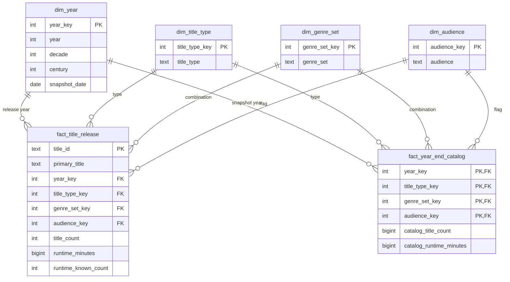
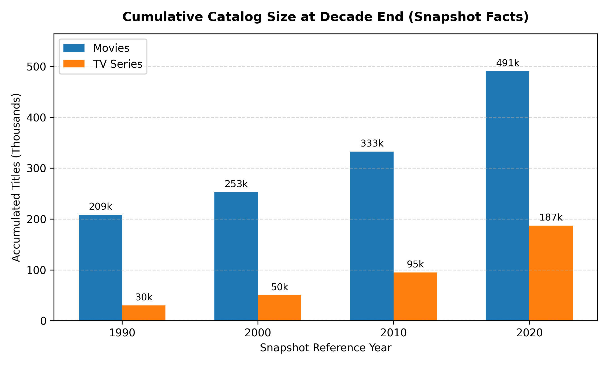
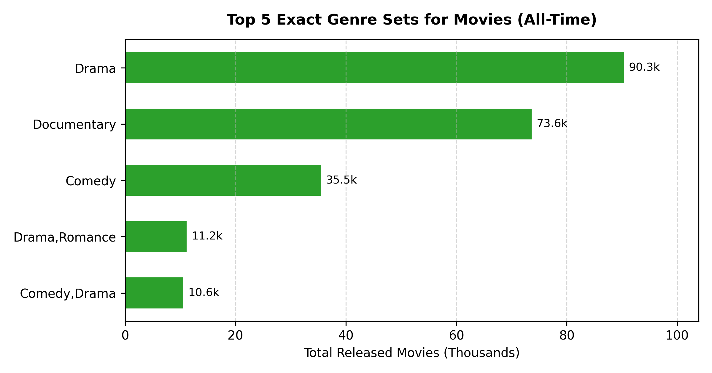

# Dimensional Analysis of IMDb Audiovisual Titles

Download the project dataset from [Google Drive](https://drive.google.com/file/d/1vTW1wmApo5b8ZvQGzIOJ8E2XF4GIFgJc/view?usp=sharing).

## 1. Subject Description and Assignment Requirements

### 1.1. Subject and Objectives

This project analyses the evolution of audiovisual titles represented in an
IMDb metadata extract. It examines releases by year and the growth of the
cumulative catalog, distinguishing title types, genre combinations, and adult
content flags.

The model supports two analytical processes: counting titles in their release
or start year, and reconstructing the total number of titles released by the
end of each year. This allows analysis of both annual activity and the
cumulative size of the catalog represented in the extract.

The main analytical questions are:

- How has the annual number of released titles evolved?
- Which title types and genre combinations are most represented?
- How are releases distributed by adult content flag?
- What are the total known runtime and average known runtime by category and year?
- How many titles in the extract had been released by a given year?
- How has the composition of the cumulative catalog evolved?

### 1.2. Data Source and Scope

The source is the local `data.tsv` file, containing 7,697,093 records and the
fields `tconst`, `titleType`, `primaryTitle`, `originalTitle`, `isAdult`,
`startYear`, `endYear`, `runtimeMinutes`, and `genres`.

The file contains title metadata; it does not contain sales, revenue, viewing
figures, platform availability, or ratings. Analysis therefore focuses on the
number and characteristics of the titles present in this extract. The
acquisition date and extract version are not recorded in the project.

Records are included when `startYear` is numeric and falls between 1 and the
configured cutoff year. For series, this field represents the start year.
Titles without an eligible year are excluded without inventing dates. All
eligible title types are retained, including movies, series, and episodes.

The current results, recorded in [validation_report.json](refined/validation_report.json), are:

| Indicator | Value |
| --- | ---: |
| Source records | 7,697,093 |
| Release fact table records | 6,901,413 |
| Records excluded due to unknown or out-of-range years | 795,680 |
| Titles with known positive runtime | 2,138,467 |
| Total known runtime, in minutes | 94,369,177 |
| Snapshot fact table records | 402,194 |
| Time range | 1874–2026 |

The current cutoff is 2026. As of the preparation date, 2 November 2026, this
year is still incomplete. The snapshot identified by `2026-12-31` is a
conventional year-end reference calculated from the available extract, rather
than an observation made on that date. To analyse only complete calendar years,
regenerate the dataset with `--cutoff-year 2025`.

### 1.3. Mapping to Assignment Requirements

| Assignment requirement | Implementation |
| --- | --- |
| More than 10,000 facts | `fact_title_release` contains 6,901,413 records. |
| At least one additive measure | `title_count`, `runtime_minutes`, and `runtime_known_count` in the release fact table. |
| Aggregated facts or snapshots with a semi-additive measure | `fact_year_end_catalog` contains cumulative counts and runtimes, additive across categories within the same year but not across years. |
| At least four dimensions, including a temporal dimension | Year, title type, genre combination, and adult content flag. |
| Dimensions shared by both types of facts | All four dimensions are shared by both fact tables. |

The snapshots represent a **reconstructed release catalog**: they count titles
in this extract whose release/start year is earlier than or equal to the year
being analysed. They do not represent the actual contents of the IMDb database
at each historical date. If the assignment requires historically observed
operational snapshots, an additional source with dated observations will be
necessary.

## 2. Dimensional Planning

### 2.1. Dimensional Bus Matrix

The matrix relates analytical processes to conformed dimensions: dimensions
with the same members, keys, and meaning in both processes.

| Process / fact table | Year | Title type | Genre combination | Adult content flag |
| --- | :---: | :---: | :---: | :---: |
| Releases — `fact_title_release` | X | X | X | X |
| Annual cumulative catalog — `fact_year_end_catalog` | X | X | X | X |

In the first table, the year identifies the title's release/start year. In the
second, it identifies the snapshot reference year. The dimension is shared,
but its temporal role depends on the process being analysed.

### 2.2. Dimension Dictionary

The following are proposed logical types for import into a relational
database. CSV files do not enforce types, keys, or constraints. Category keys
are integers assigned by the transformation process.

#### Time Dimension — `dim_year`

Grain: one record per year, including years without releases between the
first eligible year and the configured cutoff. It currently contains 153 members.

| Attribute | Logical type | Role | Description |
| --- | --- | --- | --- |
| `year_key` | INTEGER | PK | Numeric natural key for the year. |
| `year` | INTEGER | Attribute | Calendar year. |
| `decade` | INTEGER | Attribute | First year of the decade, calculated using integer division; for example, 1990. |
| `century` | INTEGER | Attribute | Calendar century; for example, 2000 belongs to the 20th century and 2001 to the 21st. |
| `snapshot_date` | DATE | Attribute | Conventional reference date of 31 December in that year. |

Supports aggregation from year to decade or from year to century. Decade and
century are alternative groupings: the decade convention used can cross a
century boundary. A strict decade → century hierarchy is not assumed.
The source used does not provide release months or days.

#### Title Type Dimension — `dim_title_type`

Grain: one record per source title type. It currently contains 13 members.

| Attribute | Logical type | Role | Description |
| --- | --- | --- | --- |
| `title_type_key` | INTEGER | PK | Surrogate key for the title type. |
| `title_type` | TEXT | Attribute | Original category, such as `movie`, `short`, or `tvEpisode`. |

#### Genre Combination Dimension — `dim_genre_set`

Grain: one record per distinct genre combination after sorting and removing
duplicates. It currently contains 2,244 members, including the `Unknown` member
for unknown genres.

| Attribute | Logical type | Role | Description |
| --- | --- | --- | --- |
| `genre_set_key` | INTEGER | PK | Surrogate key for the combination. |
| `genre_set` | TEXT | Attribute | Normalised genre list, such as `Comedy,Romance`, or `Unknown`. |

Each title belongs to exactly one combination. Analysis of `Comedy,Romance`
refers to that exact combination, rather than all comedy or romance titles.

#### Adult Content Flag Dimension — `dim_audience`

Grain: one record per interpreted value of `isAdult`. It currently contains
two observed members; the process also supports an `Unknown` member.

| Attribute | Logical type | Role | Description |
| --- | --- | --- | --- |
| `audience_key` | INTEGER | PK | Surrogate key for the classification. |
| `audience` | TEXT | Attribute | `Not adult-flagged`, `Adult-flagged`, or `Unknown`. |

This indicator is not an age rating and does not establish that an unflagged
title is suitable for children.

### 2.3. Fact Dictionary

#### Release Facts — `fact_title_release`

Grain: one record per source title with an eligible year. The proposed logical
key is `title_id`, corresponding to `tconst`. Uniqueness must be enforced when
importing into the database; the current script does not explicitly check it.

| Attribute | Logical type | Role | Description / aggregation |
| --- | --- | --- | --- |
| `title_id` | TEXT | Proposed PK | IMDb title identifier. |
| `primary_title` | TEXT | Descriptive | Main title name; not unique. |
| `year_key` | INTEGER | FK → `dim_year` | Release/start year. |
| `title_type_key` | INTEGER | FK → `dim_title_type` | Title type. |
| `genre_set_key` | INTEGER | FK → `dim_genre_set` | Genre combination. |
| `audience_key` | INTEGER | FK → `dim_audience` | Adult content flag. |
| `title_count` | INTEGER | Additive measure | Value of 1 per record; aggregated by summation. |
| `runtime_minutes` | BIGINT | Additive measure | Known positive runtime in minutes; zero when unknown or invalid. |
| `runtime_known_count` | INTEGER | Additive measure | Value of 1 when valid positive runtime exists, and 0 otherwise. |

The identifier acts as a degenerate dimension: it identifies the title without
creating an additional dimension containing millions of members. The name is
retained as a descriptive attribute in the detail fact table.

Average known runtime is a derived **non-additive** measure:

```text
average known runtime = SUM(runtime_minutes) / SUM(runtime_known_count)
```

Use decimal division and return null when the denominator is zero. Group
averages must not be summed or combined using an unweighted average of
averages; they must be recalculated from totals and counts.

#### Cumulative Catalog Facts — `fact_year_end_catalog`

Grain: one record per reference year × title type × genre combination × adult
content flag. The logical primary key combines the four foreign keys.

| Attribute | Logical type | Role | Description / aggregation |
| --- | --- | --- | --- |
| `year_key` | INTEGER | PK component; FK → `dim_year` | Snapshot reference year. |
| `title_type_key` | INTEGER | PK component; FK → `dim_title_type` | Type of the accumulated titles. |
| `genre_set_key` | INTEGER | PK component; FK → `dim_genre_set` | Genre combination. |
| `audience_key` | INTEGER | PK component; FK → `dim_audience` | Adult content flag. |
| `catalog_title_count` | BIGINT | Semi-additive measure | Cumulative number of titles with a release/start year up to the reference year. |
| `catalog_runtime_minutes` | BIGINT | Semi-additive measure | Cumulative sum of the known runtimes of those titles. |

Both measures can be summed across types, genre combinations, and
classifications within the same year. They must not be summed across years,
since a title is included again in subsequent snapshots. To obtain the catalog
at the end of a period, select the snapshot for that period's final year.

## 3. Dimensional Data Model Explained

### 3.1. Structure and Relationships

The model is a **fact constellation**, consisting of two stars sharing four
dimensions. Each fact row references exactly one member of each dimension.
Each dimension member can be associated with zero or more rows in each fact table.



The diagram represents the proposed relational model. At this stage, the
implementation consists of CSV files rather than database tables with active
constraints.

### 3.2. Rationale for Design Decisions

**Separating the two processes.** The release fact table answers questions
about what was released in a given year. The snapshot fact table answers
questions about what had already been released by that year. Separating them
makes their different grains and aggregation rules explicit.

**Conformed dimensions.** Both processes use the same keys and descriptions,
allowing annual activity and the cumulative catalog to be compared using the
same filters. There is no direct relationship between the fact tables.
Comparing them requires first aggregating each table to the desired common
grain, avoiding row multiplication caused by a direct join.

**Genre combinations.** The source allows multiple genres per title.
Representing each combination as a single member maintains disjoint categories
and preserves count additivity. Future analysis by individual genre would
require a title–genre bridge and explicit rules for distinct counting or
measure allocation.

**Annual temporal precision.** Since only the release/start year is used, the
time dimension has an annual grain. The 31 December date identifies the
snapshot reference date rather than an actual release date.

**Unknown runtime.** Unknown, non-numeric, or non-positive values contribute
zero to total runtime and zero to `runtime_known_count`. This zero is an
aggregation convention; it does not mean that the title actually lasts zero minutes.

### 3.3. Snapshot Construction and Interpretation

For each category combination, the process accumulates measures for titles
whose release/start year is no later than the snapshot year:

```text
catalog_title_count(year, categories)
    = sum of title_count for the same groups where release_year <= year

catalog_runtime_minutes(year, categories)
    = sum of runtime_minutes for the same groups where release_year <= year
```

After a combination first appears, a snapshot is produced for every subsequent
year up to the cutoff, even when there are no new releases. Combinations not
yet observed are omitted and correspond to zero.

For example, if a category has 10 titles released by 2020 and another 3 in
2021, its snapshots contain 10 and 13. Adding 10 + 13 does not represent 23
distinct titles: it counts the earlier 10 titles again. The cumulative catalog
in 2021 contains 13 titles.

### 3.4. Analytical Limitations

- Snapshots are reconstructed from the current extract: they do not show which
  titles were present in IMDb in each historical year.
- A released title remains in the cumulative catalog. `endYear` is not used as
  a removal date, because the end of a series does not remove its title.
- Coverage depends on the extract and on known years. Counts do not establish
  the total volume of worldwide audiovisual production.
- The year 2026 is incomplete, and the extract does not establish that all
  titles assigned to that year had actually been released by the preparation date.
- Movies, series, and episodes are distinct entities in the source. Specific
  analyses should filter by type. Summing runtimes across series and episodes
  does not necessarily represent minutes of unique content.
- The adult content flag does not replace an age rating.

## 4. Transformation, Execution, and Validation

The [refine_dataset.py](refine_dataset.py) script uses only Python's standard
library and preserves the source file. The process:

1. Reads `data.tsv` and selects records with eligible years.
2. Normalises genre combinations and interprets the adult content flag.
3. Assigns category keys and writes release facts.
4. Generates the four shared dimensions.
5. Accumulates measures by year and category and writes snapshots.
6. Checks the fact count threshold and reconciles final totals, generating the report.

Run in PowerShell from the project directory:

```powershell
# Reproduce the current version's cutoff
.\venv\Scripts\python.exe refine_dataset.py --cutoff-year 2026

# Alternative using only complete calendar years
.\venv\Scripts\python.exe refine_dataset.py --cutoff-year 2025
```

Execution replaces the generated files in `refined/`. To preserve a version,
use another directory with `--output refined_2025`.

| Generated file | Contents |
| --- | --- |
| `dim_year.csv` | Time dimension. |
| `dim_title_type.csv` | Title types. |
| `dim_genre_set.csv` | Genre combinations. |
| `dim_audience.csv` | Adult content flags. |
| `fact_title_release.csv` | Facts per title. |
| `fact_year_end_catalog.csv` | Annual cumulative snapshots. |
| `validation_report.json` | Counts, exclusions, and control totals. |

The script checks that there are more than 10,000 release facts and that the
sums in the final snapshot match the total title count and known runtime in
the release fact table. These checks do not replace uniqueness and referential
integrity validation when importing into a database. Surrogate keys depend on
the source reading order; dimensions and facts must be loaded together from
the same execution.

## 5. Querying and Data Analysis

This section exemplifies the use of the dimensional model to extract analytical insights from the IMDb metadata. The queries presented utilize both fact tables, taking advantage of their additive and semi-additive properties, and cross-reference multiple conformed dimensions.

### 5.1. Analytical Questions Addressed

To demonstrate the capabilities of the data warehouse, five core analytical questions were explored:

1. How has the volume of releases and their average runtime evolved across decades for movies and TV series?
2. How has the size of the cumulative catalog for movies and TV series grown across the last four decades?
3. Which title types exhibit the highest proportion of adult-flagged content?
4. What is the data quality regarding runtime information, specifically the percentage of missing values per title type?
5. What are the top 5 most frequent exact genre sets for movies overall, and how does dimensional modeling affect this ranking?

### 5.2. Data Interpretation and Insights

The queries were executed using an in-memory SQLite database populated with the generated CSV files. The results highlight the distinction between the observed data within the IMDb extract, the underlying market realities, and the analytical implications of the chosen dimensional grain.

**A. Evolution of TV Formats vs. Movies (Query 1)**

The release fact table (`fact_title_release`) was grouped by decade and title type to calculate the average known runtime.

-   **Observed Results:** The data shows that the average runtime for movies has remained highly stable over the last four decades, consistently hovering between 89 and 92 minutes. In stark contrast, the average runtime for TV series (`tvSeries`) dropped significantly, from around 52 minutes in the 1980s and 1990s, to approximately 41 to 44 minutes in the 2010s and 2020s.
-   **Interpretation:** This sharp decline does not necessarily mean that traditional television episodes have become shorter. Instead, it reflects a structural shift in the audiovisual market. The explosion of web series, short-form animated shows, and non-traditional digital formats in recent decades pulls the global average down, diluting the classic "1-hour" broadcast television format within the dataset.


**B. The Cumulative Catalog Growth (Query 2)**

To measure the historical growth of the catalog, the snapshot fact table (`fact_year_end_catalog`) was filtered for the closing years of recent decades (1990, 2000, 2010, 2020).

-   **Observed Results:** The cumulative catalog of TV series nearly doubled in a single decade, jumping from ~94,000 titles accumulated by 2010 to over 187,000 titles by 2020. Movie titles also saw substantial growth, reaching nearly half a million accumulated titles by 2020.
-   **Interpretation:** This exponential growth visually captures the "Streaming Wars" era of the 2010s, characterized by massive capital injection into serialized production. However, part of this growth is also an artifact of dataset coverage: the digitalization of media and the democratization of IMDb submissions mean that modern titles are much more exhaustively recorded than older productions. *Note: Summing the snapshot measures across these milestone years was strictly avoided, as it would violate the semi-additive nature of the table and count the same titles multiple times.*



**C. Distribution of Adult-Flagged Content Across Title Types and Decades (Query 3)**

By cross-referencing `dim_title_type`, `dim_audience` and `dim_year`, the analysis isolates the adult-flagged titles and follows how their format mix changes over time. Each format is read as a percentage of the adult-flagged titles of its own decade (and, in the figure, of its own year) rather than as a raw count. This matters because the volume of adult-flagged titles grows roughly 42× between the 1970s (3,105 titles) and the 2010s (131,180), so raw counts would let the most recent decades drown out everything before them.

-   **Observed Results:** The format mix is almost completely replaced over five decades, in three successive handovers. Across the whole period, TV episodes account for 56.6% of the 232,891 adult-flagged titles, home video for 38.3% and theatrical movies for only 3.8%.
    -   **1970s, the theatrical era:** movies make up 86.2% of adult-flagged titles. Most of the remaining 12.5% is shorts (a follow-up check over 1970–1985 puts shorts at 7.4%), while video is still marginal at 1.2%.
    -   **1980s–1990s, home video takes over:** video jumps from 1.2% to 45.3% in the 1980s, almost level with movies (52.2%), and reaches 90.5% in the 1990s, when movies are down to 7.7%. Movies peak in absolute terms in the 1980s (3,399 titles) and never return to that volume.
    -   **2000s–2010s, TV episodes take over:** episodes go from under 1% in the 1990s to 34.0% in the 2000s and 76.7% in the 2010s (100,590 titles). Video is still the majority in the 2000s (64.1%, its absolute peak at 40,810 titles) but falls to 21.6% in the 2010s. It also falls in absolute terms (28,346 titles), so its loss of share is not just dilution by a growing total.
    -   **Everything else:** theatrical movies stay at or below roughly 1.5% from the 2000s onwards, and shorts plus all remaining formats combined stay under 2% from the 1980s onwards.
-   **Interpretation:** The data shows three successive handovers (theatrical movies, then home video, then TV episodes), each leading format giving up most of its share within one to two decades. This is consistent with adult production moving away from film-based distribution towards home video and later towards episodic, online-style distribution. The data only shows how IMDb classifies these titles, so the causes behind the shifts remain an interpretation. After the 1980s, theatrical movies are a negligible share, which fits the idea that this content rarely follows traditional theatrical pipelines.
-   **Data Notes and Limitations:** The 2020s are truncated: the source holds almost no adult-flagged titles after 2021 (9,478 in 2020, 1,312 in 2021, 2 in each of 2022 and 2023, none afterwards), so that decade reflects essentially two years (87.7% TV episodes, 10.1% video) and is not comparable to a full decade. For the same reason the figure stops at 2020. The percentages describe what adult-flagged content is made of, not how much of each format is adult-flagged, which would require each format's full catalog as the denominator.

The figure below shows the same composition at annual resolution (1970–2020), which makes the timing of each handover visible. For every year, each ridge is a format's share of that year's adult-flagged titles, so the five ridges always add up to 100%. Shorts get their own ridge because of their weight in the early years, while all remaining types (including `tvSeries`) are grouped as "Other types". Years with fewer than 25 adult-flagged titles are omitted so that tiny samples do not distort the percentages.


**D. Data Quality and Completeness (Query 4)**

A critical role of a data warehouse is exposing operational data quality issues. The release fact table was queried to compare total releases (`title_count`) against titles with valid durations (`runtime_known_count`).

-   **Observed Results:** The analysis reveals severe data sparsity regarding technical metadata. Approximately 82.7% of all recorded TV episodes (`tvEpisode`) and 99.3% of video games (`videoGame`) completely lack runtime information.
-   **Interpretation:** This demonstrates that IMDb's operational data collection prioritizes cataloging the existence of a title over its secondary technical metadata. For analytical purposes, this validates the inclusion of the `runtime_known_count` additive measure in the model: any aggregation of "average duration" that divides by total row counts rather than known runtime counts would be severely distorted.


**E. Genre Sets and the Combinatorial Fragmentation Effect (Query 5)**

Querying `fact_title_release` with `dim_genre_set` for theatrical movies (`movie`) reveals the top five exact genre strings recorded in the warehouse.

-   **Observed Results:** Standalone `'Drama'` (90.3k) and `'Documentary'` (73.6k) rank first and second by a wide margin, followed by standalone `'Comedy'` (35.5k), `'Drama,Romance'` (11.2k), and `'Comedy,Drama'` (10.6k).
-   **Interpretation:** While it might initially appear that documentaries are the second most produced film genre in history—outnumbering comedies by more than two to one—this ranking is heavily influenced by **combinatorial fragmentation**. Because our dimensional model treats each exact combination of genres as a mutually exclusive member in `dim_genre_set` (to preserve strict count additivity without a many-to-many bridge table), genres that rarely mix with others—such as `'Documentary'`—remain concentrated under a single dimension key. Conversely, highly hybrid genres like *Comedy*, *Action*, or *Adventure* are co-tagged with multiple sub-genres (`'Action,Adventure,Sci-Fi'`, `'Comedy,Drama'`, `'Comedy,Romance'`), splintering their true total volume across hundreds of distinct dimension members.

