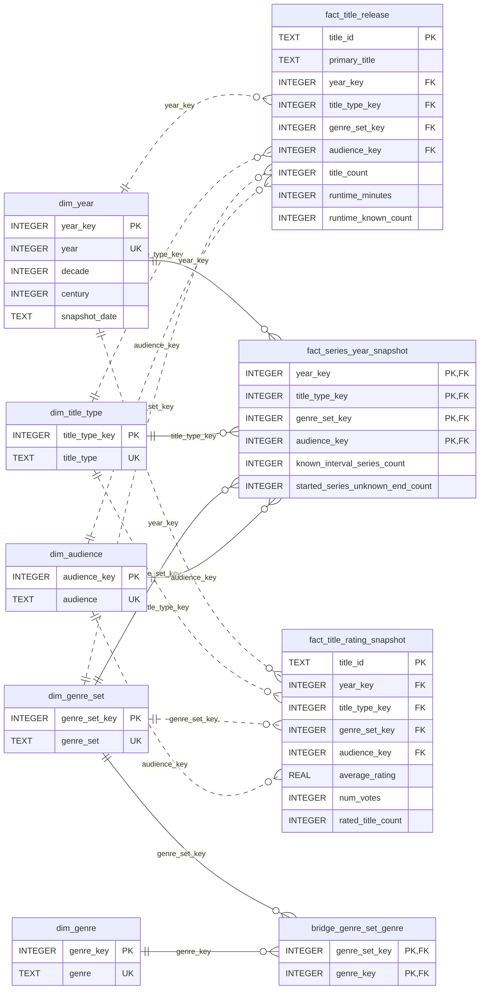

# Dimensional Analysis of IMDb Titles and Ratings

This README follows the seven parts of the assignment and serves as the basis for the project report. It describes the implemented model, the ETL process and the measured analytical results. The persistent warehouse is [data/warehouse/warehouse.db](data/warehouse/warehouse.db); its physical schema is defined in [warehouse_schema.sql](sql/warehouse_schema.sql).

1. [Subject description. Assignment requirements.](#1-subject-description-assignment-requirements)
2. [Planning: dimensional bus matrix, dimensions and facts dictionary.](#2-planning-dimensional-bus-matrix-dimensions-and-facts-dictionary)
3. [Dimensional data model explained.](#3-dimensional-data-model-explained)
4. [Data sources selection. Extraction, transformation and loading.](#4-data-sources-selection-extraction-transformation-and-loading)
5. [Querying and data analysis.](#5-querying-and-data-analysis)
6. [Critical reflection about the advantages and shortcomings with respect to operational databases.](#6-critical-reflection-about-the-advantages-and-shortcomings-with-respect-to-operational-databases)
7. [Conclusion.](#7-conclusion)

## 1. Subject description. Assignment requirements.

### 1.1. Subject and analytical objectives

The subject is the catalogue of audiovisual titles represented in IMDb, including movies, television series, episodes and other title types. The project transforms title metadata and user-rating summaries into a dimensional warehouse for descriptive analysis.

Three analytical processes define the scope: counting titles by release/start year, reconstructing annual series interval information, and analysing the ratings available in a dated extract. The main questions are:

- How do release volume, title types and genre representation vary over time?
- How do known runtimes and metadata completeness differ between categories?
- How many recorded series intervals cover each year, and how many already-started series have an unknown end year?
- What proportion of titles have ratings, and how do current ratings vary by type, release decade and genre?
- How does a minimum vote threshold affect comparisons and movie rankings?

These questions concern the titles present in the datasets, not all worldwide audiovisual production. The sources do not contain revenue, viewing figures, individual votes or dated broadcasting events. A vote count is not a count of viewers, and a missing series end year does not establish that a series is still airing.

The project uses `title.basics.tsv` and `title.ratings.tsv`, downloaded from IMDb on **12 November 2026 (12/11/2026)**. Eligible titles have a numeric start year between 1 and the configured cutoff, currently 2026. Section 4 explains source selection and exclusion rules.

### 1.2. Mapping to assignment requirements

| Requirement | Implementation and evidence |
| --- | --- |
| More than 10,000 facts | `fact_title_release` contains **11,460,001** eligible title records. |
| At least one additive measure | Release `title_count`, `runtime_minutes` and `runtime_known_count` can be summed across disjoint title groups. |
| Aggregated facts or snapshots with a semi-additive measure | `fact_series_year_snapshot` has **66,964** aggregate rows. Its series counts are additive across disjoint categories within a year, but not across years as distinct-series totals. |
| At least four dimensions, including time | Year, title type, genre combination and adult-content flag are directly referenced by all three facts. |
| Dimensions shared by the analytical processes | The same conformed dimensions and genre membership bridge are reused across facts. |
| Additional ratings analysis | `fact_title_rating_snapshot` contains **1,731,185** rated-title observations with one row per eligible rated title in the current snapshot. |

The model contains three fact tables. The genre bridge and `warehouse_metadata` support relationships and provenance respectively; neither is an additional fact table.

## 2. Planning: dimensional bus matrix, dimensions and facts dictionary

### 2.1. Dimensional bus matrix

| Process / fact table | Year role | Title type | Genre combination | Adult flag | Individual genre |
| --- | --- | --- | --- | --- | --- |
| `fact_title_release` | Release/start | X | X | X | Via bridge |
| `fact_series_year_snapshot` | Reference year | X | X | X | Via bridge |
| `fact_title_rating_snapshot` | Release/start | X | X | X | Via bridge |

All three fact tables use conformed category dimensions. A year key has a different analytical role in the series snapshot. The same genre bridge supports all three processes.

### 2.2. Dimensions dictionary

| Table / grain | Keys and attributes | Interpretation |
| --- | --- | --- |
| `dim_year`: one calendar year | PK `year_key`; `year`, `decade`, `century`, `snapshot_date` | Continuous years from first eligible title through cutoff. `snapshot_date` is a conventional 31 December label, not an observed state on that day. |
| `dim_title_type`: one source type | PK `title_type_key`; `title_type` | Movies, episodes, series and other types are kept distinct. |
| `dim_genre_set`: one normalized combination | PK `genre_set_key`; `genre_set` | Sorted, deduplicated labels; unknown combinations become `Unknown`. |
| `dim_genre`: one individual genre | PK `genre_key`; `genre` | Supports membership searches including mixed combinations. |
| `bridge_genre_set_genre`: combination x genre | Composite PK/FKs `genre_set_key`, `genre_key` | One membership per genre. This is a relationship table, not a fact table. |
| `dim_audience`: one adult-flag category | PK `audience_key`; `audience` | `Not adult-flagged`, `Adult-flagged`, `Unknown`; not an age certification. |

Category surrogate keys are integers assigned by ETL. Year is a natural integer key. Decade and century are alternative rollups, not a strict hierarchy (the 2000 decade crosses a century boundary). Names and dates use TEXT; counts use INTEGER; ratings use REAL in SQLite STRICT tables.

### 2.3. Facts dictionary

**`fact_title_release`** has one row per eligible title, keyed by `title_id` (IMDb `tconst`, a degenerate identifier). It retains `primary_title`, and FKs to year, type, genre combination and audience. Measures:

- `title_count = 1`: additive across disjoint title groups.
- `runtime_minutes`: positive known duration, or zero as an additive placeholder.
- `runtime_known_count`: 1 for positive known duration, otherwise 0.
- Mean known runtime = `SUM(runtime_minutes) / SUM(runtime_known_count)`; missing durations are excluded from the denominator.

**`fact_series_year_snapshot`** has one row per reference year x type x genre combination x audience, with those four FKs as its composite PK. Only `tvSeries` and `tvMiniSeries` contribute. Measures:

- `known_interval_series_count`: recorded valid start/end interval covers the year, including both endpoints.
- `started_series_unknown_end_count`: series started by that year with a missing end year in this extract.

Both measures are additive across disjoint categories within one year, but semi-additive over time: summing years counts reporting-year memberships, not distinct series. Missing end year does **not** establish ongoing broadcasting. These measures are separate and must never be added as an airing total. Even a known interval cannot prove episodes aired in every year.

**`fact_title_rating_snapshot`** has one row per eligible rated title in the current snapshot, with PK `title_id`. It directly references release/start year, type, genre combination and audience dimensions. Each refresh replaces the snapshot rather than appending observations. It carries:

| Measure | Meaning | Aggregation |
| --- | --- | --- |
| `average_rating` | IMDb weighted rating, between 1 and 10 | Non-additive. `AVG` gives an equal-title mean among rated titles, not an average of individual votes. |
| `num_votes` | Accumulated votes for the title in the current extract | Additive across distinct titles in the current snapshot. Counts votes, not unique users. |
| `rated_title_count = 1` | Presence of an eligible rated title | Additive across distinct titles in the current snapshot. |

### 2.4. Keys, physical types and measure classification

The dictionaries describe the implemented [SQL schema](sql/warehouse_schema.sql). All dimension keys and count measures are `INTEGER`, descriptive attributes and ISO dates are `TEXT`, and `average_rating` is `REAL`. PK means primary key; FK means foreign key.

| Fact | Primary key | Direct foreign keys | Additional attributes |
| --- | --- | --- | --- |
| `fact_title_release` | `title_id` (TEXT) | `year_key`, `title_type_key`, `genre_set_key`, `audience_key` | `primary_title` (TEXT) |
| `fact_series_year_snapshot` | All four dimension keys together | `year_key`, `title_type_key`, `genre_set_key`, `audience_key` | None |
| `fact_title_rating_snapshot` | `title_id` (TEXT) | `year_key`, `title_type_key`, `genre_set_key`, `audience_key` | None |

Each FK references the same-named key in its dimension. The genre bridge has two integer FKs, which together form its PK. The ratings file SHA-256 and download date are stored in `ratings_provenance` in the ETL validation report, also embedded in `warehouse_metadata.source_report_json`. This load-level provenance is separate from the release/start year and is not a dimension.

| Measure | Physical type | Classification | Correct use |
| --- | --- | --- | --- |
| `title_count` | INTEGER | Additive | Count titles in disjoint release groups. |
| `runtime_minutes` | INTEGER | Additive | Sum known durations. |
| `runtime_known_count` | INTEGER | Additive | Denominator for the mean known runtime. |
| `known_interval_series_count` | INTEGER | Semi-additive | Sum disjoint categories within one reference year. |
| `started_series_unknown_end_count` | INTEGER | Semi-additive | Sum disjoint categories within one reference year. |
| `average_rating` | REAL | Non-additive | Calculate an explicitly labelled equal-title mean within one extract. |
| `num_votes` | INTEGER | Additive within the current snapshot | Sum votes across distinct titles and disjoint category groups. |
| `rated_title_count` | INTEGER | Additive within the current snapshot | Count rated titles in disjoint groups. |

## 3. Dimensional data model (explained)

### 3.1. Structure and relationships

The model is a fact constellation: three fact tables share conformed dimensions. One release is a title-level record, one series snapshot row aggregates a year and category combination, and one current rating record describes an eligible rated title. Releases and current ratings both have title-level grain, but represent different processes and populations: unrated titles still belong to releases. Keeping ratings separate makes that optional coverage explicit. Joining the aggregate series rows directly to title-level facts would multiply measures unless they are first aggregated to compatible grains.

Missing ratings produce no rating fact and never become zero. Release facts remain available for coverage denominators. The rating PK guarantees at most one current rating per title, so rating queries join directly to releases by `title_id`. The ETL reconciles the shared identifier and all category keys; fact-to-fact SQL joins are restricted to this controlled grain. Series/release comparisons aggregate each table to the same grain before drill-across.

The rating fact does not have an FK to another fact table: shared dimensions describe the process, while the title identifier supports cross-process reconciliation. Load validation rejects orphan rating titles and inconsistent dimension keys.



**Diagram notation.** `PK` marks a primary-key column, `FK` a foreign key and `UK` a unique attribute. All four `PK, FK` columns of `fact_series_year_snapshot` together form its composite PK; the two bridge columns likewise form one composite PK. Each fact or bridge row references **exactly one** parent dimension member; a dimension member may be referenced by **zero or many** rows (`1 : 0..N`). Solid relationships identify children through a parent key; dashed relationships use FKs outside the child's PK. These cardinalities describe the physical schema.

There is no physical FK between the release and rating facts. Their optional one-rating-per-title correspondence is checked during loading, as explained above. `warehouse_metadata` is omitted because it is provenance, not a dimensional entity.

For the report, download the [vector diagram (SVG)](media/dimensional_model.svg) or [printable diagram (PDF)](media/dimensional_model.pdf). The [Mermaid source](docs/dimensional_model.mmd) and embedded diagram are generated from the actual SQL schema with `python -m scripts.model_diagram`; Graphviz is optional for SVG/PDF export.


### 3.2. Design decisions

**Conformed dimensions.** Using the same category keys and labels allows comparisons between processes without redefining title types, genres or adult flags. The year dimension is shared, but its role must be stated: a release/start year in releases and ratings, and a reference year in series snapshots.

**Title identity.** `title_id` retains IMDb's `tconst` as a degenerate identifier. There is no separate `dim_title` in this implementation. `primary_title` is retained in the release fact for readable search and ranking results. Ratings use the shared identifier to retrieve the title name with at most one current rating per title.

**Multiple genres.** Each title references one normalized genre combination. A bridge connects that combination to individual genres, so a Comedy search includes Comedy,Romance. Summing exact combinations is safe because they are disjoint; summing individual-genre groups can count the same title more than once. The bridge is stored once per combination and genre rather than once per title and genre.

**Missing information.** Unknown genre combinations and adult flags have explicit labels when encountered. Missing ratings create no rating fact and are not replaced with zero. For runtime, the zero placeholder is paired with a known-value indicator, so it does not enter the mean as a real zero-minute duration.

**Temporal scope.** A year dimension matches the granularity of the title source; month and day of release are not invented. The ratings download date and source hash are load-level metadata. Because the warehouse stores only the current ratings snapshot, an extraction dimension and a per-row extraction key are unnecessary. The `snapshot` name describes the current state; it does not imply retained periodic history. A future historical model would need a dated observation key and a different primary key before appending ratings for the same title.

### 3.3. How the series snapshot is constructed

For a valid known interval, a series contributes from its start year through its end year, inclusive, capped by the reporting cutoff. For an unknown end, it contributes to the separate already-started/unknown-end measure from its start year through cutoff. The ETL uses additions at the start and subtractions after the last included year rather than materialising every series-year row before aggregation.

For example, a series starting in 2018 and ending in 2020 contributes to the known-interval measure in 2018, 2019 and 2020. A series starting in 2019 with no end year contributes to the unknown-end measure from 2019 through 2026. The latter contribution expresses missing metadata, not evidence of continued broadcasting.

These annual rows reconstruct intervals from the current extract. They are not observations of what IMDb knew at each historical year-end. Summing a count over years gives reporting-year memberships, not distinct series or proven years of activity.

### 3.4. Physical implementation and validation

The persistent SQLite schema uses `STRICT` tables, PKs, FKs and CHECK constraints. A trigger restricts the series snapshot to `tvSeries` and `tvMiniSeries`. Indexes support filtering releases by type/year and genre combination, series snapshots by genre combination, and reverse genre membership lookups. Constraints and load-time reconciliation establish structural consistency; they do not prove the factual accuracy of source metadata.

`warehouse_metadata` stores the ETL provenance and validation results. Schema version 4 prevents an older database from being silently used with the ratings model. These physical choices support the implementation but do not change the grain or meaning of the facts.

## 4. Data sources selection. Extraction, transformation and loading.

### 4.1. Sources and selection rationale

| Source | Relevant fields | Analytical role |
| --- | --- | --- |
| `title.basics.tsv` | `tconst`, `titleType`, `primaryTitle`, `originalTitle`, `isAdult`, `startYear`, `endYear`, `runtimeMinutes`, `genres` | Title population, release facts, categories and series intervals. |
| `title.ratings.tsv` | `tconst`, `averageRating`, `numVotes` | Ratings and accumulated vote counts for a subset of titles. |

Both datasets were downloaded manually from **IMDb on 12/11/2026** and decompressed into `data/raw/`:

- [IMDb dataset documentation](https://data.imdb.com/non-commercial-datasets/).
- [title.basics.tsv.gz](https://datasets.imdbws.com/title.basics.tsv.gz).
- [title.ratings.tsv.gz](https://datasets.imdbws.com/title.ratings.tsv.gz).
- [IMDb usage conditions](https://help.imdb.com/article/imdb/general-information/can-i-use-imdb-data-in-my-software/G5JTRESSHJBBHTGX): personal/non-commercial use subject to the stated restrictions, not unrestricted redistribution rights.

Information courtesy of IMDb (https://www.imdb.com). Used with permission.

These sources provide a common title identifier, temporal attributes, descriptive categories and sufficient volume for dimensional analysis. Ratings extend the analytical questions without excluding unrated titles from the release population. The download date records acquisition, not the timestamp of the last vote or a guarantee that the files were published simultaneously. SHA-256 hashes and byte sizes identify the exact inputs in [validation_report.json](data/refined/validation_report.json).

The previous professor-provided `data/raw/data.tsv` is retained as a reference. The newer basics file contains 12,953,566 titles versus 7,697,093 in the previous source. A full identifier comparison found 7,514,596 common titles, 5,438,970 only in the new extract and 182,497 only in the previous one. Among common titles, 2,064,624 changed, and missing runtimes were filled for 1,118,073 titles. The newer source therefore expands coverage and updates metadata, but is not simply the old file with additional rows and does not improve every record.

### 4.2. Extraction, transformation and loading workflow

The implementation is in [refine_dataset.py](scripts/refine_dataset.py), [ratings_etl.py](scripts/ratings_etl.py) and [build_warehouse.py](scripts/build_warehouse.py).

1. **Acquisition:** datasets downloaded from IMDb on **12/11/2026** and decompressed into `data/raw/title.basics.tsv` and `data/raw/title.ratings.tsv`. No scraping is used.
2. **Extraction:** read UTF-8 TSV with literal tabs and no CSV quote interpretation. Check mandatory columns and malformed records. Preserve source hashes, sizes, URLs and download date.
3. **Title transformation:** retain numeric start years from 1 through cutoff (default 2026). Count missing, malformed and out-of-range years separately. Preserve all eligible types. Normalize genre combinations and adult flags; distinguish missing and invalid/nonpositive runtimes.
4. **Series transformation:** use start and end+1 deltas to construct annual aggregates efficiently. Missing ends contribute to the separate unknown-end count through cutoff. Invalid ends exclude only the series snapshot contribution; releases are retained.
5. **Rating transformation:** validate unique `tconst`, finite ratings between 1 and 10 and positive integer votes; reject invalid input. Join to eligible releases and copy conformed keys. Report unmatched ratings (absent or excluded titles) separately. Emit the rating fact CSV with one row per title and keep download date, URL, hash and byte size in the validation report. No rating is imputed.
6. **Publication:** write to a staging directory and roll back ordinary publication failures. Failed rating validation also leaves previously published outputs intact.
7. **Loading:** create a temporary SQLite database with PKs, FKs, STRICT types and CHECK constraints; load dimensions and all three facts; create indexes; validate integrity, row counts, measures, genre memberships, series types and rating/release alignment. Publish by atomic replacement only after successful validation.

`warehouse_metadata` stores build time, ETL report and validation results. It is operational metadata, not a dimensional fact table. Schema version **4** prevents an old database from being queried as the new model. Series snapshot semantics remain version 2.

Refreshes rebuild the complete warehouse. The rating PK enforces one row per title; the current snapshot is replaced on refresh and historical ratings are not retained. Changes to category metadata are not tracked as slowly changing dimensions. Missing dates and future years are reported rather than invented. 2026 is incomplete at acquisition, and records in that year need not have been released by 12 November.

### 4.3. Data-quality controls and current load results

| Control / result | Records |
| --- | ---: |
| Source title records | 12,953,566 |
| Eligible release facts | 11,460,001 |
| Excluded titles with missing start year | 1,487,454 |
| Excluded titles with malformed start year | 0 |
| Excluded titles with numeric year outside cutoff | 6,111 |
| Eligible titles with positive known runtime | 4,635,541 |
| Eligible titles with missing runtime | 6,824,456 |
| Eligible titles with invalid/nonpositive runtime | 4 |
| Eligible titles with unknown genres | 462,579 |
| Eligible titles with unknown adult flag | 0 |
| Eligible series | 351,646 |
| Series with a known end year | 164,343 |
| Series with an unknown end year | 187,303 |
| Series excluded from snapshots due to invalid end | 0 |
| Annual series snapshot rows | 66,964 |
| Source ratings | 1,731,454 |
| Eligible rating facts | 1,731,185 |
| Ratings without an eligible title match | 269 |

The counts reconcile: source titles equal eligible titles plus exclusions, and source ratings equal integrated ratings plus unmatched ratings. The latter include absent titles or titles excluded by year rules; the current aggregate does not distinguish the two causes. Missing runtime is recorded separately from invalid or nonpositive runtime, even though both are omitted from runtime means.

The loaded year dimension spans 1874 to 2026. There are 11 title types, 2,362 genre combinations, 29 individual genre members, 2 audience members observed in eligible titles, 6,684 genre memberships. The current ratings source is identified in load metadata rather than in an extra dimension. `Unknown` audience is supported by the model but was not needed in this load.

The implementation was validated with 26 tests covering transformation rules, storage constraints, duplicate/invalid ratings, matching and coverage denominators, overlapping genres and failure recovery. The full warehouse load also passed integrity, foreign-key and control-total checks. These checks validate implementation consistency rather than certify the external source as complete.

### 4.4. Reproduction commands and project organisation

Python 3.11+ and SQLite 3.37+ are required. Matplotlib is needed for figures (`python -m pip install matplotlib`); the remaining pipeline uses the standard library.

```powershell
python -m scripts.refine_dataset --cutoff-year 2026 --download-date 2026-11-12
python -m scripts.build_warehouse
python -m scripts.run_queries
python -m scripts.runtime_diagnostics
python -m scripts.analysis_report
python -m scripts.model_diagram
python -m unittest discover -s tests
```

Alternative paths: ETL accepts `--source`, `--ratings-source`, and `--output`; loading accepts `--source` and `--database`; queries accept `--database`. Set `--download-date` accurately when loading a later download. Use `--no-plots` to export query results without Matplotlib. `python -m scripts.build_warehouse --verify` checks the existing database without rebuilding.

```powershell
python -m scripts.run_queries --genre Comedy --genre Romance --snapshot-year 2025
```

The genre-search command uses OR membership with `EXISTS`, so a title matching both genres is counted once. Querying the warehouse does not rerun ETL or recreate the database.

| Location | Purpose |
| --- | --- |
| `data/raw/` | Original and updated sources |
| `data/refined/` | Intermediate dimension/fact CSVs and validation report |
| `data/warehouse/warehouse.db` | Persistent queryable database |
| `sql/warehouse_schema.sql` | Enforced physical model |
| `scripts/` | ETL, loading, queries and report generation |
| `data/analysis_results.json` | Full results of all ten analytical queries |
| `data/runtime_diagnostics.json` | Runtime distributions, sensitivity results and source tracing |
| `docs/dimensional_model.mmd` | ER diagram source generated from the physical schema |
| `docs/Data_Analysis.md` | Reproducible results and interpretation |
| `media/` | Eight analytical figures and SVG/PDF model diagrams |
| `tests/` | Transformation, storage, queries and failure recovery tests |

## 5. Querying and data analysis

### 5.1. Querying approach

The queries run against the existing persistent warehouse. The SQL is maintained in [run_queries.py](scripts/run_queries.py) and [rating_queries.py](scripts/rating_queries.py). All ten result sets are available in [analysis_results.json](data/analysis_results.json); complete tables and additional interpretation are in [Data_Analysis.md](docs/Data_Analysis.md). The following subsections include the main measured findings directly in this report base.

Additive measures use sums over disjoint groups. Runtime means divide total known duration by the number of known durations. Series/release drill-across aggregates both facts to year before joining. Rating queries use the current snapshot, with one row per rated title, and preserve unrated releases when calculating coverage. Individual-genre analyses use the bridge and explicitly treat genre groups as overlapping.

### 5.2. Query 1: release volume and average known runtime

| Release decade | Movies | Movies with known runtime | Runtime coverage | Mean known runtime (minutes) |
| --- | ---: | ---: | ---: | ---: |
| 1980s | 44,567 | 33,314 | 74.8% | 92.0 |
| 1990s | 46,367 | 34,004 | 73.3% | 92.4 |
| 2000s | 79,315 | 64,558 | 81.4% | 89.5 |
| 2010s | 170,083 | 137,903 | 81.1% | 89.6 |
| 2020s, incomplete | 138,945 | 104,863 | 75.5% | 91.9 |

Recorded movie volume rises substantially between the 1980s and 2010s, while the mean known duration stays near 90 minutes. This describes the extract and does not by itself establish worldwide production growth. Runtime coverage varies, and the 2020s cannot be treated as a completed decade.

#### Investigation of the series-runtime anomaly

Supplement to Query 1, restricted to `tvSeries`. Missing/invalid runtimes are excluded from all duration statistics and reported through coverage. Percentiles use linear interpolation at `(n - 1) * p`. No source values or warehouse facts are changed.

| Start decade | Eligible series | Known runtimes | Coverage | Mean (min) | Median (min) | P95 | P99 | Maximum |
| --- | ---: | ---: | ---: | ---: | ---: | ---: | ---: | ---: |
| 1980s | 12,488 | 6,737 | 53.95% | 50.12 | 30.00 | 120.00 | 333.84 | 4,800 |
| 1990s | 22,278 | 11,090 | 49.78% | 50.18 | 30.00 | 120.00 | 252.33 | 8,400 |
| 2000s | 47,186 | 22,739 | 48.19% | 213.21 | 30.00 | 120.00 | 312.00 | 3,692,080 |
| 2010s | 105,195 | 36,442 | 34.64% | 41.71 | 30.00 | 100.00 | 210.00 | 6,834 |
| 2020s | 73,765 | 21,511 | 29.16% | 93.72 | 35.00 | 120.00 | 270.00 | 1,000,000 |

The largest recorded value is **The Angry Grandpa Show** (`tt7493646`, start year 2007): **3,692,080 minutes**. This one record accounts for **76.16%** of the 2000s known-runtime sum. Removing only this largest observation for comparison reduces the mean from **213.21 to 50.84 minutes**. The median is **30 minutes**.

The top ten values were checked against `title.basics.tsv`; their type, start year and runtime match the warehouse. The extreme value therefore originates in the source, rather than the ETL conversion. This check does not establish whether the source value is erroneous, cumulative, or uses another interpretation of series duration. It is not justified to label it a normal episode length or silently replace it.

| 2000s sensitivity scenario | Observations removed | Share removed | Mean remaining (min) |
| --- | ---: | ---: | ---: |
| Keep runtimes <= 120 min | 877 | 3.86% | 40.35 |
| Keep runtimes <= 240 min | 293 | 1.29% | 43.97 |
| Keep runtimes <= 1,440 min | 15 | 0.07% | 49.43 |

The 120, 240 and 1,440 minute limits are illustrative sensitivity thresholds (two hours, four hours and one day), not validated definitions of a correct series runtime. Their differing results show why an arbitrary cutoff cannot be presented as a correction. For comparisons, report median, upper percentiles, coverage and the unmodified mean together.

| Title ID | Series | Start year | Source and warehouse runtime (min) |
| --- | --- | ---: | ---: |
| tt7493646 | The Angry Grandpa Show | 2007 | 3,692,080 |
| tt13281484 | P3aksjonen | 2009 | 6,000 |
| tt0804414 | Desire | 2006 | 3,900 |
| tt37300532 | Historias de fuego | 2007 | 2,610 |
| tt3675380 | Ariel Mothers aka Ariel Maa | 2000 | 2,288 |

Reproduce with `python -m scripts.runtime_diagnostics`. The complete statistics and original source records for the ten largest values are stored in `data/runtime_diagnostics.json`.


The revised figure displays the full, unmodified mean without clipping the 2000s peak. A second panel compares the median with the mean after excluding only the largest value in each decade. The panels show different summaries of the same known-runtime population.


### 5.3. Query 2: new series, known intervals and unknown ends

| Reference year | New series | Known intervals covering year | Started series with unknown end |
| --- | ---: | ---: | ---: |
| 2000 | 3,633 | 6,408 | 25,878 |
| 2010 | 8,137 | 9,484 | 56,734 |
| 2020 | 17,470 | 13,974 | 137,119 |
| 2026, incomplete | 11,244 | 5,144 | 187,303 |

The three columns answer different questions: a release flow, coverage by recorded intervals and a cumulative count of missing end metadata. The large unknown-end count makes an inferred airing total unjustified. The lower known-interval count for 2026 cannot establish a decline in broadcasting: unknown ends and the incomplete reference year constrain interpretation.


### 5.4. Query 3: adult-flagged titles by decade and format

In the 1990s, 18,672 of 20,437 adult-flagged titles have source type `video`. In the 2010s, `tvEpisode` accounts for 156,640 of 196,985 titles. In the incomplete 2020s, episodes account for 90,345 of 104,926 titles, or 86.1%.

These results show a change in the composition of recorded title types. They do not measure audience demand, revenue or distribution-channel migration. Query aliases such as `theatrical_movie` and `home_video` refer to the source categories `movie` and `video`; they are not independently verified release channels. The annual chart stops at 2025 to exclude incomplete 2026. Five 2D panels use the same 0-100% scale, so each source type can be compared without perspective or occlusion. A sixth panel shows the annual denominator. Each percentage uses all adult-flagged titles in that year; years with fewer than 25 titles are omitted and any gaps are retained.


### 5.5. Query 4: runtime completeness

Among categories with more than 10,000 eligible titles, the proportion without a positive known runtime is 99.00% for video games, 66.76% for television episodes, 60.36% for television series and 25.47% for movies. The query's missing-runtime count includes invalid/nonpositive values; ETL reports those separately.

The same measure is not equally documented or equally meaningful across formats. Runtime-based conclusions must therefore report the known-value denominator. Replacing missing durations with zero in the mean would systematically understate duration.


### 5.6. Query 5: individual genres versus exact combinations

Drama appears in 242,235 movies, but only 117,513 of them have Drama as their sole genre (48.5%). Comedy appears in 110,296 movies, of which 42,603 have Comedy alone (38.6%). For Romance, the standalone share is only 14.6%.

This demonstrates why an exact-combination filter is insufficient for an individual-genre question. The bridge recovers mixed-genre titles. The resulting genre groups overlap and cannot be summed into a distinct movie total.


### 5.7. Query 6: series intervals by individual genre

Comedy has 2,437 known series intervals covering 2010 and 3,320 covering 2020. Drama rises from 1,718 to 3,223 over those reference years. However, the separate 2020 unknown-end counts are 29,892 for Comedy and 16,654 for Drama.

The query demonstrates reuse of the same genre bridge for aggregate facts. The differences describe interval metadata; they do not prove changes in annual broadcasting activity. Each series may also contribute to several genre groups.


### 5.8. Query 7: rating coverage and mean by title type

Overall, **1,731,185 of 11,460,001 eligible titles have a rating (15.11%)**. The remaining 9,728,816 titles remain in release analyses. Coverage differs substantially by type:

| Type | Eligible titles | Rated titles | Coverage | Mean title rating |
| --- | ---: | ---: | ---: | ---: |
| Movie | 646,320 | 351,620 | 54.40% | 6.15 |
| TV series | 282,338 | 115,559 | 40.93% | 6.77 |
| TV miniseries | 69,308 | 26,612 | 38.40% | 7.09 |
| Short | 1,123,485 | 185,933 | 16.55% | 6.78 |
| TV episode | 8,731,703 | 895,749 | 10.26% | 7.42 |

Episodes dominate the title population but have relatively low rating coverage, helping explain the low overall percentage. Their higher mean rating describes only the rated subset; it does not demonstrate that episodes are intrinsically better than movies. The query also reports accumulated votes, which count votes rather than unique users or viewers.


### 5.9. Query 8: ratings by release decade and vote threshold

| Movie release decade | Rated movies | Mean of all rated movies | Movies with at least 1,000 votes | Mean with threshold |
| --- | ---: | ---: | ---: | ---: |
| 1960s | 17,991 | 6.03 | 2,043 | 6.61 |
| 2000s | 48,551 | 6.20 | 8,493 | 6.20 |
| 2010s | 95,784 | 6.22 | 14,565 | 6.07 |
| 2020s, incomplete | 72,167 | 6.27 | 10,134 | 6.10 |

The vote threshold raises the mean for the 1960s but lowers it for the 2010s and 2020s. Its effect is therefore not uniform: it changes the population selected for analysis. These are ratings in the 2026 extract grouped by release decade, not ratings observed in each historical decade. Older titles have had more time to accumulate votes.


### 5.10. Query 9: ratings by individual genre

| Genre | Rated movies | Rating coverage | Mean title rating | Mean with at least 1,000 votes |
| --- | ---: | ---: | ---: | ---: |
| Drama | 159,054 | 65.66% | 6.20 | 6.49 |
| Documentary | 58,038 | 40.90% | 7.17 | 7.19 |
| Comedy | 84,065 | 76.22% | 5.88 | 6.15 |
| Horror | 27,410 | 79.32% | 4.96 | 5.25 |

Documentary has a higher mean than these other selected genres but lower rating coverage. The comparison is descriptive and does not establish an objective genre-quality hierarchy. Genre groups overlap, and coverage and vote support differ. The complete results include sample sizes for the thresholded populations and smaller genre groups, which need particular care.

### 5.11. Query 10: movie ranking with a minimum vote count

The query selects movies with at least 10,000 votes and orders them by rating descending, vote count descending, then identifier. The first three results are:

| Movie | Release year | Rating | Votes |
| --- | ---: | ---: | ---: |
| The Shawshank Redemption | 1994 | 9.3 | 3,263,940 |
| The Godfather | 1972 | 9.2 | 2,271,916 |
| The Dark Knight | 2008 | 9.1 | 3,249,572 |

The complete top 20 is in [Data_Analysis.md](docs/Data_Analysis.md). This is a project-defined ranking, not IMDb's official Top 250. The 10,000-vote threshold makes the support criterion explicit but does not remove selection bias or establish objective quality. Likewise, the 1,000-vote threshold in Queries 8 and 9 is a sensitivity-analysis choice.

IMDb's published rating is already weighted. An equal-title mean answers a question about title ratings; weighting those values again by vote count would not reconstruct the raw mean of individual votes.

## 6. Critical reflection about the advantages and shortcomings with respect to operational databases

### 6.1. Operational and analytical purposes

An operational database typically supports frequent, detailed business operations, such as creating a title record, correcting metadata or recording a vote. A dimensional warehouse supports comparisons and aggregation across many records. Both can be implemented in a relational database: using SQLite does not make this project operational, and using dimensional tables does not remove the need for integrity constraints.

The source here is a pair of published TSV extracts. IMDb's internal operational database design is not available to this project. The following comparison therefore concerns typical operational and analytical requirements, not a claim about IMDb's actual internal architecture.

| Aspect | Typical operational database | This dimensional warehouse |
| --- | --- | --- |
| Main workload | Frequent inserts, updates and detailed record lookups | Aggregations by release/reference year, type, genre and audience, including current ratings |
| Organisation | Often normalized around entities and business transactions | Facts with declared grains and shared descriptive dimensions |
| Freshness | Reflects committed operational changes | Reflects the downloaded files until the next full refresh |
| Detail | Can retain individual events required by the application | Retains title-level facts and aggregate series intervals; no individual votes |
| Consistency | Constraints support valid operational changes | Constraints plus ETL reconciliation support consistent analytical measures |
| Historical information | Depends on operational audit/history design | Current title metadata and one rating extract; annual intervals are reconstructed |
| Performance objective | Efficient short transactions and concurrent changes | Efficient scanning and grouping for the defined questions; no comparative benchmark was performed |

### 6.2. Advantages of the dimensional approach

The declared grains and reusable measures make analytical questions easier to express consistently. For example, runtime comparisons use the same known-duration denominator, and ratings coverage always uses the eligible release population. Conformed dimensions support comparisons between processes without translating categories for every query.

Precomputed annual series aggregates avoid repeatedly expanding title intervals for each analysis. The genre bridge provides a reusable solution for mixed-genre membership. Shared dimensions and indexes can reduce repeated transformation work and simplify query paths, although no measured speedup over an operational alternative is claimed.

The warehouse also separates analytical processing from a hypothetical live transactional workload. In this implementation, all analysis occurs on local copies and does not query IMDb's operational systems. Provenance, constraints and repeatable ETL make the input version and transformation rules auditable.

### 6.3. Shortcomings and trade-offs

The warehouse requires additional storage for source files, intermediate CSVs, dimensions, facts and indexes. Full refreshes consume processing time and disk space; the staged and temporary outputs needed for safe publication add further overhead. Compared with a live operational system, the information becomes stale between downloads.

The analytical model also selects and summarizes information. `originalTitle` is not carried into the warehouse, series snapshots lose individual title identity, and the ratings source has no individual votes. New questions may therefore require revisiting the raw data or acquiring a different source. Title metadata is not versioned as slowly changing dimensions, and previous rating extracts are not retained by the current refresh process.

Denormalized analytical structures need coordinated loading: title classifications are copied into the rating fact, so ETL and validation must keep them aligned with releases. Direct edits outside the pipeline can violate that alignment even when individual FKs remain valid. Precomputed snapshots must be regenerated when source intervals change.

Dimensional modelling does not eliminate analytical mistakes. Joining facts at incompatible grains can multiply rows; overlapping genre groups can double-count titles; accumulated votes cannot be added across extracts; and means need clear denominators. These constraints require documentation and disciplined query design as well as database checks.

### 6.4. Source limitations and analytical validity

Only 15.11% of eligible titles have ratings, and the large differences in coverage show that the rated subset is not interchangeable with the full catalogue. Minimum vote thresholds change the analysed population rather than curing that selection problem. Rating and genre comparisons remain descriptive.

Missing end years leave series status indeterminate, while even known intervals cannot reveal hiatuses or prove annual activity. Runtime completeness differs by title type, and a positive duration is not sufficient to guarantee a comparable meaning across formats. The current year and decade are incomplete, and title counts reflect IMDb coverage as well as the phenomena being studied.

These are limits on the conclusions that can be drawn from the sources. A well-formed dimensional schema improves consistency and accessibility but cannot supply observations that the datasets do not contain.

## 7. Conclusion

The warehouse integrates the IMDb datasets downloaded on 12/11/2026 into three fact tables sharing four direct dimensions and a genre bridge. The resulting 11,460,001 release facts, 66,964 series aggregate rows and 1,731,185 rating observations support the original questions. Ten analytical queries, a reproducible runtime investigation and eight figures provide four main conclusions:

1. **How have recorded releases and genres evolved?** The catalogue contains 44,567 movies released in the 1980s and 170,083 in the 2010s, about **3.82 times as many**. This is growth in recorded catalogue coverage, not a measured worldwide production rate. Genre membership must include mixed combinations: Drama appears in 242,235 movies, but only **48.5%** have Drama alone.
2. **Are duration differences representative of typical titles?** The apparent **213.21-minute** mean for series starting in the 2000s is dominated by one source record accounting for **76.16%** of the runtime sum. Without that single observation the mean is **50.84 minutes**, while the median is **30 minutes**. The evidence supports reporting distribution and sensitivity measures, rather than concluding that a typical 2000s series is unusually long. The raw-source check establishes where the value came from, not whether its meaning is correct.
3. **What can be established about series over time?** For 2026, **5,144** recorded known intervals cover the reference year and **187,303** already-started series have unknown end dates. These measures describe different metadata states and cannot be added into an airing total. The model answers interval and missingness questions, but the available source cannot establish actual annual broadcasting activity.
4. **How representative are the ratings and comparisons?** Ratings cover **15.11%** of eligible titles, with **54.40%** coverage for movies and **10.26%** for episodes. Coverage therefore needs to accompany any mean. A minimum of 1,000 votes changes the 1960s movie mean from **6.03 to 6.61**, but changes the 2010s mean from **6.22 to 6.07**: the selection rule affects cohorts differently and does not remove selection bias.

The assignment requirements are supported by declared grains, additive release measures, semi-additive series counts and conformed dimensions. ETL reconciliation and 26 tests check implementation consistency. The model improves analytical consistency and traceability, while requiring storage, refresh and maintenance effort. It cannot repair missing observations or ambiguous source semantics by itself.

The next useful steps are to investigate the meaning of extreme source durations, retain dated rating observations when historical analysis is required, and acquire dated episode-level evidence for broadcasting questions. Ratings grouped by release year remain a description of the current extract, not a historical measure of opinion.
