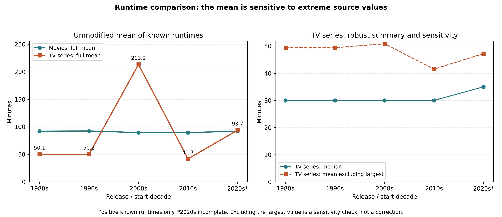
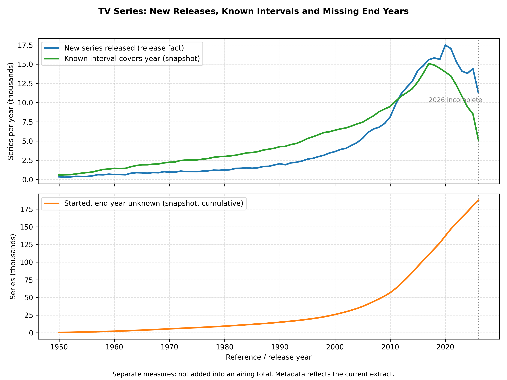
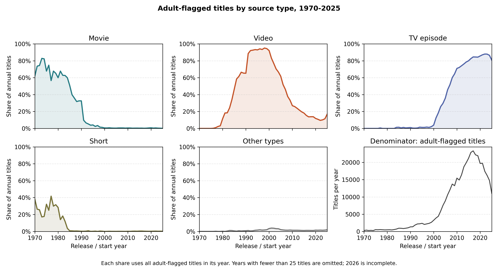
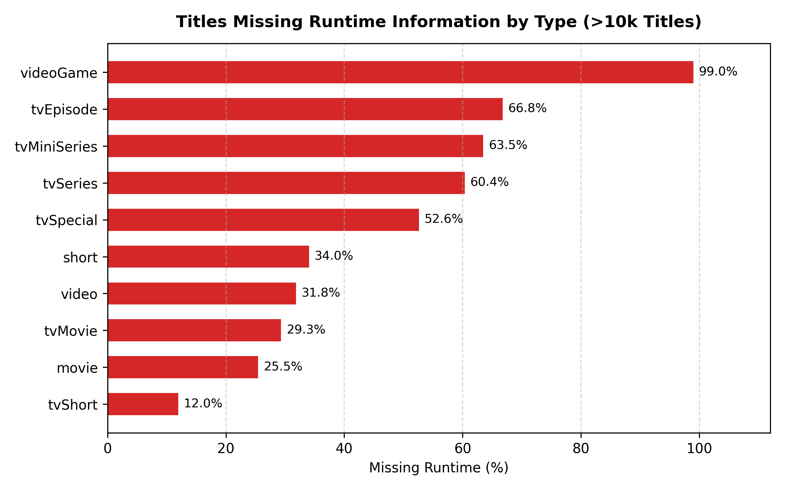
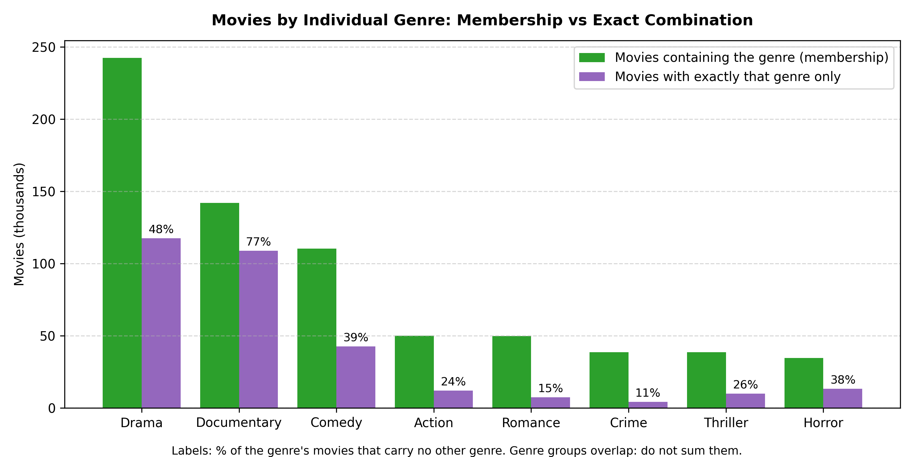
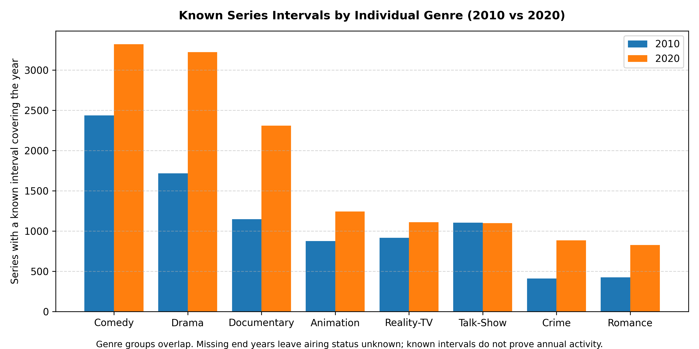
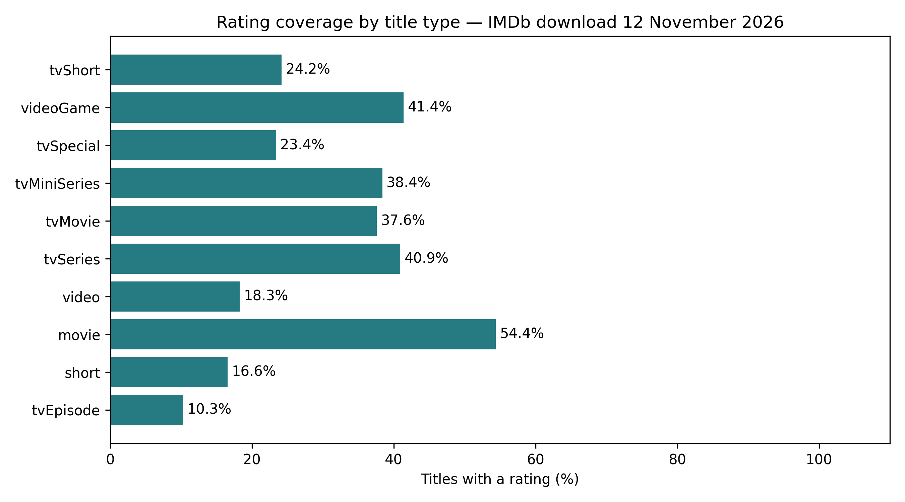
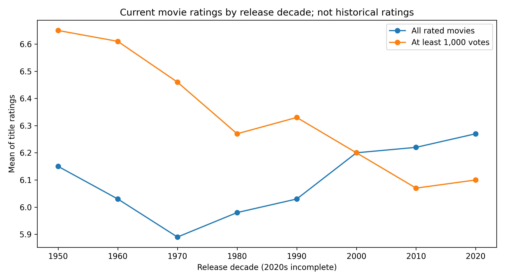

# Data analysis — IMDb download 12 November 2026

Generated from the current ETL controls and executed warehouse queries. All ratings refer to the current snapshot, with one row per rated title; 2026 and the 2020s are incomplete. Download date and source hash are ETL provenance, not a dimensional axis; the warehouse does not retain rating history.

## Population and data quality

| Indicator | Value |
| --- | ---: |
| Source title records | 12,953,566 |
| Eligible release facts | 11,460,001 |
| Excluded missing start years | 1,487,454 |
| Excluded malformed start years | 0 |
| Excluded numeric years outside cutoff | 6,111 |
| Known positive runtimes | 4,635,541 |
| Missing runtimes | 6,824,456 |
| Invalid or nonpositive runtimes | 4 |
| Unknown genre combinations | 462,579 |
| Unknown adult flags | 0 |
| Series snapshot rows | 66,964 |
| Eligible series | 351,646 |
| Series with known end | 164,343 |
| Series with unknown end | 187,303 |
| Series excluded due to invalid end | 0 |
| Source ratings | 1,731,454 |
| Eligible rating facts | 1,731,185 |
| Ratings without eligible title | 269 |
| Eligible titles without rating | 9,728,816 |
| Votes on eligible titles | 1,799,223,692 |

**Rating coverage is 15.11%** of eligible titles. The remaining 84.89% have no rating in this extract. A larger catalogue can lower this percentage even while matching more rating records. Unmatched ratings include titles absent from basics or excluded by the year rules; this aggregate does not distinguish those causes.

The year dimension spans 1874–2026. Dimension member counts: {'title_type': 11, 'genre_set': 2362, 'audience': 2, 'genre': 29}. The genre bridge has 6,684 memberships.

## 1. [Additive] Release Volume and Average Known Runtime (Movies vs TV Series by Decade)

Counts are additive; mean duration uses only titles with a positive known runtime. Changes in runtime may reflect changing metadata coverage as well as title composition. The 2020s are a partial decade and must not be compared as a completed decade.

| decade | title_type | total_releases | titles_with_runtime | pct_with_runtime | avg_runtime_mins |
| --- | --- | --- | --- | --- | --- |
| 2020 | movie | 138945 | 104863 | 75.5 | 91.9 |
| 2020 | tvSeries | 73765 | 21511 | 29.2 | 93.7 |
| 2010 | movie | 170083 | 137903 | 81.1 | 89.6 |
| 2010 | tvSeries | 105195 | 36442 | 34.6 | 41.7 |
| 2000 | movie | 79315 | 64558 | 81.4 | 89.5 |
| 2000 | tvSeries | 47186 | 22739 | 48.2 | 213.2 |
| 1990 | movie | 46367 | 34004 | 73.3 | 92.4 |
| 1990 | tvSeries | 22278 | 11090 | 49.8 | 50.2 |
| 1980 | movie | 44567 | 33314 | 74.8 | 92.0 |
| 1980 | tvSeries | 12488 | 6737 | 53.9 | 50.1 |

The 2020s contain 138,945 eligible movies, with 75.5% runtime coverage and a mean known duration of 91.9 minutes. These three quantities describe volume, completeness and duration separately.

### Runtime anomaly investigation

Supplement to Query 1, restricted to `tvSeries`. Missing/invalid runtimes are excluded from all duration statistics and reported through coverage. Percentiles use linear interpolation at `(n - 1) * p`. No source values or warehouse facts are changed.

| Start decade | Eligible series | Known runtimes | Coverage | Mean (min) | Median (min) | P95 | P99 | Maximum |
| --- | ---: | ---: | ---: | ---: | ---: | ---: | ---: | ---: |
| 1980s | 12,488 | 6,737 | 53.95% | 50.12 | 30.00 | 120.00 | 333.84 | 4,800 |
| 1990s | 22,278 | 11,090 | 49.78% | 50.18 | 30.00 | 120.00 | 252.33 | 8,400 |
| 2000s | 47,186 | 22,739 | 48.19% | 213.21 | 30.00 | 120.00 | 312.00 | 3,692,080 |
| 2010s | 105,195 | 36,442 | 34.64% | 41.71 | 30.00 | 100.00 | 210.00 | 6,834 |
| 2020s | 73,765 | 21,511 | 29.16% | 93.72 | 35.00 | 120.00 | 270.00 | 1,000,000 |

The largest recorded value is **The Angry Grandpa Show** (`tt7493646`, start year 2007): **3,692,080 minutes**. This one record accounts for **76.16%** of the 2000s known-runtime sum. Removing only this largest observation for comparison reduces the mean from **213.21 to 50.84 minutes**. The median is **30 minutes**.

The top ten values were checked against `title.basics.tsv`; their type, start year and runtime match the warehouse. The extreme value therefore originates in the source, rather than the ETL conversion. This check does not establish whether the source value is erroneous, cumulative, or uses another interpretation of series duration. It is not justified to label it a normal episode length or silently replace it.

| 2000s sensitivity scenario | Observations removed | Share removed | Mean remaining (min) |
| --- | ---: | ---: | ---: |
| Keep runtimes <= 120 min | 877 | 3.86% | 40.35 |
| Keep runtimes <= 240 min | 293 | 1.29% | 43.97 |
| Keep runtimes <= 1,440 min | 15 | 0.07% | 49.43 |

The 120, 240 and 1,440 minute limits are illustrative sensitivity thresholds (two hours, four hours and one day), not validated definitions of a correct series runtime. Their differing results show why an arbitrary cutoff cannot be presented as a correction. For comparisons, report median, upper percentiles, coverage and the unmodified mean together.

| Title ID | Series | Start year | Source and warehouse runtime (min) |
| --- | --- | ---: | ---: |
| tt7493646 | The Angry Grandpa Show | 2007 | 3,692,080 |
| tt13281484 | P3aksjonen | 2009 | 6,000 |
| tt0804414 | Desire | 2006 | 3,900 |
| tt37300532 | Historias de fuego | 2007 | 2,610 |
| tt3675380 | Ariel Mothers aka Ariel Maa | 2000 | 2,288 |

Reproduce with `python -m scripts.runtime_diagnostics`. The complete statistics and original source records for the ten largest values are stored in `data/runtime_diagnostics.json`.

## 2. [Drill-across] New Series (releases) vs Known Intervals vs Started with Unknown End, by Year

Each process is first aggregated by year, avoiding multiplication of facts. New releases are a flow; interval and unknown-end measures describe different populations. An unknown end cannot establish ongoing broadcasting. Historical rows use current metadata.

| year | new_series | known_intervals | started_unknown_end |
| --- | --- | --- | --- |
| 1960 | 650 | 1453 | 2245 |
| 1970 | 975 | 2254 | 5614 |
| 1980 | 1248 | 3007 | 9429 |
| 1990 | 2055 | 4273 | 14995 |
| 2000 | 3633 | 6408 | 25878 |
| 2010 | 8137 | 9484 | 56734 |
| 2015 | 14150 | 12682 | 93993 |
| 2018 | 15798 | 14871 | 118852 |
| 2020 | 17470 | 13974 | 137119 |
| 2021 | 17029 | 13462 | 146795 |
| 2022 | 15295 | 12259 | 155386 |
| 2026 | 11244 | 5144 | 187303 |

For 2026, there are 11,244 new series, 5,144 known intervals covering the year, and 187,303 already-started series with an unknown end. The much larger unknown-end group makes an inferred airing total unjustified.

## 3. [Audience x Time x Title Type] Adult-Flagged Releases Across Decades by Format

The format breakdown describes adult-flagged titles, not age certifications or audience behaviour. Changes in format mix cannot establish a causal change in distribution channels.

| decade | total_adult | theatrical_movie | home_video | tv_episodes | shorts | other_formats |
| --- | --- | --- | --- | --- | --- | --- |
| 2020 | 104926 | 459 | 12248 | 90345 | 279 | 1595 |
| 2010 | 196985 | 785 | 36612 | 156640 | 544 | 2404 |
| 2000 | 83434 | 431 | 44875 | 36227 | 77 | 1824 |
| 1990 | 20437 | 1174 | 18672 | 245 | 60 | 286 |
| 1980 | 7289 | 3415 | 3382 | 53 | 394 | 45 |
| 1970 | 3902 | 2718 | 31 | 3 | 1149 | 1 |

In the 2020s, tv_episodes contributes 90,345 of 104,926 adult-flagged titles (86.1%). This is a share of recorded titles, not viewers or revenue.

## 4. [Data Quality] Percentage of Titles Missing Runtime Information by Category

Missingness varies by type. Runtime comparisons need the known-runtime denominator; substituting zero would artificially depress averages.

| title_type | total_titles | missing_runtime | missing_percentage |
| --- | --- | --- | --- |
| videoGame | 49472 | 48979 | 99.0 |
| tvEpisode | 8731703 | 5829522 | 66.76 |
| tvMiniSeries | 69308 | 44005 | 63.49 |
| tvSeries | 282338 | 170427 | 60.36 |
| tvSpecial | 62149 | 32709 | 52.63 |
| short | 1123485 | 382569 | 34.05 |
| video | 331475 | 105551 | 31.84 |
| tvMovie | 152722 | 44785 | 29.32 |
| movie | 646320 | 164592 | 25.47 |
| tvShort | 11028 | 1320 | 11.97 |

The highest missing-runtime percentage among the reported categories is videoGame: 99.0%, or 48,979 of 49,472 titles. Duration is not equally meaningful or equally documented for all formats.

## 5. [Genre bridge] Movies: Individual-Genre Membership vs Exact Standalone Combination

Genre membership includes mixed combinations, while standalone counts include exactly one genre. The groups overlap, so their counts cannot be added to obtain a distinct movie total.

| genre | movies_with_genre | standalone_only | pct_standalone |
| --- | --- | --- | --- |
| Drama | 242235 | 117513 | 48.5 |
| Documentary | 141892 | 108763 | 76.7 |
| Comedy | 110296 | 42603 | 38.6 |
| Action | 50042 | 12009 | 24.0 |
| Romance | 49764 | 7250 | 14.6 |
| Crime | 38517 | 4134 | 10.7 |
| Thriller | 38514 | 9886 | 25.7 |
| Horror | 34556 | 13184 | 38.2 |
| Adventure | 26950 | 3418 | 12.7 |
| Family | 18100 | 3412 | 18.9 |

Drama leads the reported movie memberships with 242,235 titles, but only 117,513 (48.5%) have that genre alone. Filtering exact combinations would omit the remaining mixed-genre titles.

## 6. [Snapshot x Genre bridge] Known Series Intervals by Individual Genre (2010 vs 2020)

This comparison uses the same genre bridge on annual series aggregates. Known intervals do not establish actual annual activity; the separate unknown-end counts show why known intervals alone are incomplete as an activity proxy.

| genre | known_2010 | known_2020 | unknown_end_2020 |
| --- | --- | --- | --- |
| Comedy | 2437 | 3320 | 29892 |
| Drama | 1718 | 3223 | 16654 |
| Documentary | 1146 | 2309 | 20783 |
| Animation | 875 | 1242 | 5718 |
| Reality-TV | 916 | 1111 | 14351 |
| Talk-Show | 1105 | 1098 | 13296 |
| Crime | 411 | 884 | 3377 |
| Romance | 425 | 827 | 3728 |

Comedy has 2,437 known intervals in 2010 and 3,320 in 2020; its separate unknown-end count in 2020 is 29,892. This difference describes recorded interval metadata, not proven growth in broadcasting.

## 7. Ratings coverage and mean by title type

Coverage differences demonstrate that availability of ratings is uneven. Mean title rating describes only rated titles; total votes count votes, not unique viewers.

| title_type | total_titles | rated_titles | coverage_pct | mean_title_rating | total_votes |
| --- | --- | --- | --- | --- | --- |
| tvEpisode | 8731703 | 895749 | 10.26 | 7.42 | 220243704 |
| short | 1123485 | 185933 | 16.55 | 6.78 | 14302556 |
| movie | 646320 | 351620 | 54.4 | 6.15 | 1308334098 |
| video | 331475 | 60541 | 18.26 | 6.63 | 12593192 |
| tvSeries | 282338 | 115559 | 40.93 | 6.77 | 185090423 |
| tvMovie | 152722 | 57476 | 37.63 | 6.56 | 16037726 |
| tvMiniSeries | 69308 | 26612 | 38.4 | 7.09 | 31033636 |
| tvSpecial | 62149 | 14551 | 23.41 | 6.75 | 3541792 |
| videoGame | 49472 | 20475 | 41.39 | 6.62 | 7468976 |
| tvShort | 11028 | 2669 | 24.2 | 6.74 | 577589 |
| tvPilot | 1 | 0 | 0.0 | — | 0 |

Among types with at least 10,000 titles, **movie** has the highest coverage (54.4%), and **tvEpisode** the lowest (10.26%). This is direct evidence against treating the overall rating mean as representative of all types.

## 8. Current movie ratings by release decade

These are current ratings grouped by release decade, not ratings recorded in each decade. Comparing all rated movies with the 1,000-vote subset tests sensitivity to low-vote titles; the threshold also changes the population and does not remove selection bias.

| decade | total_movies | rated_movies | coverage_pct | mean_title_rating | movies_1000_votes | mean_1000_votes |
| --- | --- | --- | --- | --- | --- | --- |
| 1950 | 23849 | 13362 | 56.03 | 6.15 | 1631 | 6.65 |
| 1960 | 31900 | 17991 | 56.4 | 6.03 | 2043 | 6.61 |
| 1970 | 40730 | 23950 | 58.8 | 5.89 | 2633 | 6.46 |
| 1980 | 44567 | 26675 | 59.85 | 5.98 | 3386 | 6.27 |
| 1990 | 46367 | 27760 | 59.87 | 6.03 | 4350 | 6.33 |
| 2000 | 79315 | 48551 | 61.21 | 6.2 | 8493 | 6.2 |
| 2010 | 170083 | 95784 | 56.32 | 6.22 | 14565 | 6.07 |
| 2020 | 138945 | 72167 | 51.94 | 6.27 | 10134 | 6.1 |

The largest absolute change under the vote threshold occurs in the 1960s: 6.03 for all rated movies versus 6.61 for movies with at least 1,000 votes (2,043 movies). This is a composition effect, not a before/after change in ratings.

## 9. Movie ratings and coverage by individual genre

Means give each rated movie equal weight within each genre. Coverage and the 1,000-vote subset should accompany any genre comparison. Mixed-genre movies appear in several groups; these groups are not independent or additive.

| genre | total_movies | rated_movies | coverage_pct | mean_title_rating | movies_1000_votes | mean_1000_votes |
| --- | --- | --- | --- | --- | --- | --- |
| Drama | 242235 | 159054 | 65.66 | 6.2 | 27572 | 6.49 |
| Documentary | 141892 | 58038 | 40.9 | 7.17 | 2604 | 7.19 |
| Comedy | 110296 | 84065 | 76.22 | 5.88 | 16484 | 6.15 |
| Action | 50042 | 35883 | 71.71 | 5.74 | 8982 | 5.93 |
| Romance | 49764 | 37854 | 76.07 | 6.08 | 8231 | 6.39 |
| Crime | 38517 | 30573 | 79.38 | 5.96 | 8268 | 6.3 |
| Thriller | 38514 | 30170 | 78.34 | 5.58 | 7600 | 5.82 |
| Horror | 34556 | 27410 | 79.32 | 4.96 | 6703 | 5.25 |
| Adventure | 26950 | 21187 | 78.62 | 5.85 | 5353 | 6.11 |
| Family | 18100 | 13411 | 74.09 | 6.18 | 2079 | 6.23 |
| Mystery | 17881 | 13962 | 78.08 | 5.8 | 4216 | 5.98 |
| Biography | 17199 | 11267 | 65.51 | 6.92 | 2627 | 6.9 |
| Music | 15883 | 9644 | 60.72 | 6.8 | 1502 | 6.71 |
| History | 15036 | 9958 | 66.23 | 6.76 | 1946 | 6.83 |
| Fantasy | 14728 | 10789 | 73.26 | 5.82 | 2680 | 5.94 |
| Sci-Fi | 10826 | 8290 | 76.57 | 5.32 | 2397 | 5.43 |
| Musical | 10501 | 7171 | 68.29 | 6.17 | 860 | 6.58 |
| Animation | 9314 | 6514 | 69.94 | 6.31 | 1646 | 6.63 |
| War | 9200 | 6858 | 74.54 | 6.36 | 1235 | 6.77 |
| Adult | 9021 | 4731 | 52.44 | 5.64 | 18 | 5.7 |
| Sport | 8314 | 4571 | 54.98 | 6.64 | 927 | 6.53 |
| Western | 7218 | 5151 | 71.36 | 5.82 | 669 | 6.39 |
| News | 1439 | 694 | 48.23 | 7.18 | 29 | 7.57 |
| Film-Noir | 878 | 878 | 100.0 | 6.46 | 464 | 6.85 |
| Reality-TV | 532 | 101 | 18.98 | 6.43 | 0 | — |
| Talk-Show | 210 | 31 | 14.76 | 6.76 | 1 | 6.8 |
| Game-Show | 7 | 3 | 42.86 | 7.43 | 0 | — |

## 10. Top 20 movies with at least 10000 votes

This is a project ranking of movies with at least 10,000 votes, ordered by rating, votes and identifier. It is not IMDb Top 250. The threshold improves vote support but is an analytical choice, and does not establish objective quality.

| title_id | primary_title | release_year | average_rating | num_votes |
| --- | --- | --- | --- | --- |
| tt0111161 | The Shawshank Redemption | 1994 | 9.3 | 3263940 |
| tt0068646 | The Godfather | 1972 | 9.2 | 2271916 |
| tt0468569 | The Dark Knight | 2008 | 9.1 | 3249572 |
| tt0252487 | The Chaos Class | 1975 | 9.1 | 46978 |
| tt0259534 | Ramayana: The Legend of Prince Rama | 1993 | 9.1 | 18564 |
| tt0167260 | The Lord of the Rings: The Return of the King | 2003 | 9.0 | 2207396 |
| tt0108052 | Schindler's List | 1993 | 9.0 | 1613240 |
| tt0071562 | The Godfather Part II | 1974 | 9.0 | 1523668 |
| tt0050083 | 12 Angry Men | 1957 | 9.0 | 1011690 |
| tt45368240 | You Can See Everything | 2026 | 9.0 | 31401 |
| tt15176374 | Unpaarvayil | 2025 | 9.0 | 10057 |
| tt0120737 | The Lord of the Rings: The Fellowship of the Ring | 2001 | 8.9 | 2251754 |
| tt33175825 | Attack on Titan: The Last Attack | 2024 | 8.9 | 40535 |
| tt11989890 | David Attenborough: A Life on Our Planet | 2020 | 8.9 | 36546 |
| tt5275892 | O.J.: Made in America | 2016 | 8.9 | 24294 |
| tt43383343 | BLEACH: Thousand-Year Blood War - The Calamity | 2026 | 8.9 | 18325 |
| tt0075143 | The Message | 1976 | 8.9 | 12246 |
| tt1375666 | Inception | 2010 | 8.8 | 2888709 |
| tt0137523 | Fight Club | 1999 | 8.8 | 2682784 |
| tt0109830 | Forrest Gump | 1994 | 8.8 | 2552648 |

The first movie under these rules is **The Shawshank Redemption** (1994), rated 9.3 with 3,263,940 votes.

## Figures

## Interpretation limits

The updated catalogue extends recent-year coverage, but is not a production census. Ratings are available for a selected minority of titles. Release cohorts differ in exposure time and vote accumulation. No causal claims about genre, quality or popularity follow from these descriptive comparisons. A future history of separately dated extracts would be required to measure rating changes over time.
